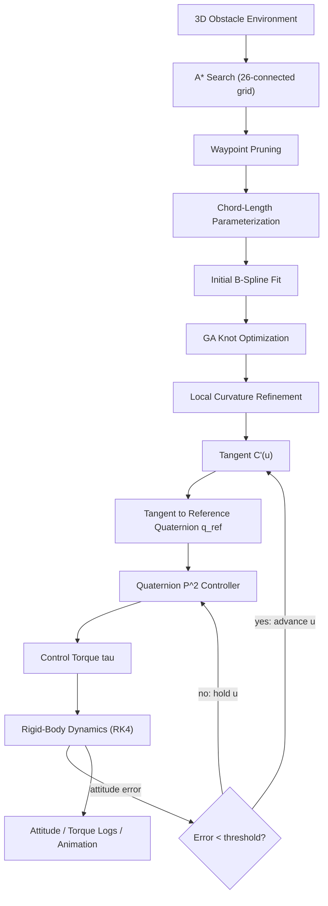
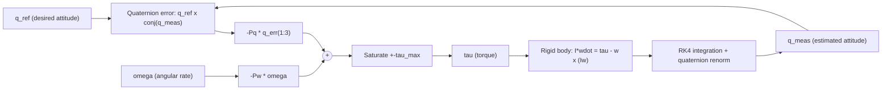

  

# Adaptive B-Spline Smoothing and Altitude Control of a Quadrotor UAV

## Team Members

| S. No. | Name | Roll Number | Email |
|---|---|---|---|
| 1 | Aparna A | cb.sc.u4aie24212 | cb.sc.u4aie24212@cb.students.amrita.edu |
| 2 | G Prajwal Priyadarshan | cb.sc.u4aie24214 | cb.sc.u4aie24214@cb.students.amrita.edu |
| 3 | Kabilan K | cb.sc.u4aie24224 | cb.sc.u4aie24224@cb.students.amrita.edu |
| 4 | Kesav Satya Sai Nimmagadda | cb.sc.u4aie24236 | cb.sc.u4aie24236@cb.students.amrita.edu |
| 5 | Vignes V M | cb.sc.u4aie24359 | cb.sc.u4aie24359@cb.students.amrita.edu |

## Abstract

This project builds an integrated UAV navigation stack by recreating and merging two published methods into a single obstacle-aware pipeline. A 3D A\* planner finds a collision-free route through a cluttered environment; a genetic algorithm reshapes that route into a curvature-bounded cubic B-Spline via adaptive knot placement; and a singularity-free quaternion P² (proportional–proportional) controller tracks the spline's local tangent in real time, so the vehicle's commanded attitude follows the path it is flying. The path parameter is gated by the attitude-tracking error, coupling guidance and control into one closed loop rather than treating them as independent stages.

Both a **Python** implementation and a **MATLAB** implementation (with 3D animations) are developed and kept in sync as far as possible. The work is based on two base papers — an adaptive B-Spline smoothing approach for UAV path planning, and Fresk & Nikolakopoulos' full quaternion-based attitude control for a quadrotor — with emphasis on recreating each paper's core algorithm faithfully before merging them.

| Paper | Contribution used here |
|---|---|
| *"An Enhanced Adaptive B-spline Smoothing Approach for UAV Path Planning"* | 3D A\* baseline path → GA-driven adaptive knot placement → curvature-constrained cubic B-Spline |
| Fresk & Nikolakopoulos, *"Full Quaternion Based Attitude Control for a Quadrotor"* (ECC 2013) | Singularity-free quaternion P² attitude/rate control law |

# Introduction

Unmanned Aerial Vehicles (UAVs), particularly quadrotors, are increasingly deployed for missions that require autonomous navigation through cluttered 3D environments — inspection, surveying, delivery. Two problems have to be solved together for such a mission to succeed: **where to fly** (path planning and smoothing) and **how to fly it** (attitude control that tracks the planned path without overshoot or instability). Treating these as fully separate stages, as is common practice, risks a controller chasing a path it cannot physically keep up with — sharp corners in a raw planner output translate into attitude commands the vehicle cannot track smoothly.

Discrete path planners such as A\* produce jagged, piecewise-linear paths that are collision-free but not flight-suitable: they contain sharp corners with unbounded curvature. Fitting a smooth curve through the waypoints is necessary, but a naive uniform B-Spline does not account for where curvature actually needs to be tightly bounded (near obstacles) versus where it can be relaxed (in open space). The first base paper addresses this with **adaptive knot placement** — a genetic algorithm searches over the spline's interior knot vector to jointly minimize path length and curvature violations, followed by a local search that nudges individual control points wherever curvature still exceeds the allowed limit.

On the control side, attitude is described by orientation in 3D, which is non-trivial to parameterize. Euler angles are intuitive but suffer from the gimbal-lock singularity; Direction Cosine Matrices avoid the singularity but are harder to work with and must maintain orthogonality. The second base paper instead represents attitude with a **unit quaternion**, a compact four-parameter representation free of geometric singularities, and derives a proportional–proportional (P²) control law that combines quaternion attitude-error feedback with angular-velocity feedback — without ever transforming through Euler angles or DCMs.

This project recreates both algorithms independently, validates each against its own paper's reported behavior, and then **merges** them: the smoothed spline's local tangent vector is converted into a reference quaternion at each point along the path, and the quaternion controller drives the simulated quadrotor toward that reference. The path parameter only advances once the attitude error has converged below a threshold, so the vehicle is never asked to fly a curve faster than it can orient itself along it.

# Methodology

## 1. Overall Methodology

The project follows a two-stage-then-merged methodology:

1. Build a 3D obstacle environment (cylinders and cuboids with safety buffers).
2. Run 3D A\* search on a 26-connected voxel grid to find a collision-free raw path.
3. Prune the raw path to a sparse set of waypoints.
4. Parameterize the waypoints by chord length.
5. Fit an initial cubic B-Spline (least-squares control-point solve).
6. Run a genetic algorithm over the interior knot vector to minimize path length subject to a curvature penalty.
7. Run a local curvature-aware refinement pass that directly nudges control points wherever curvature still exceeds the limit.
8. At each point along the resulting spline, convert the local tangent into a reference quaternion.
9. Feed the reference quaternion into a quaternion P² controller, which computes control torque from quaternion attitude error and angular-velocity feedback.
10. Integrate rigid-body rotational dynamics (RK4) to update the simulated quadrotor's attitude.
11. Advance the path parameter only once the attitude-tracking error converges below a threshold; otherwise hold position and keep correcting.
12. Log attitude, torque, quaternion error, and path progress, and render comparison plots/animations.

## 2. Methodology Flow Diagram

The path parameter `u` (position along the spline) only advances once the attitude-tracking error has converged — the drone does not outrun its own attitude loop.

## 3. Path Planning — 3D A\*

The environment is a `2000 × 2000 × 500 m` volume populated with cylinders (towers) and cuboids (buildings), each inflated by a safety **buffer**. A point `p` collides with an obstacle if it falls inside the buffered cylinder/cuboid volume.

**A\* cost model**, on a 26-connected voxel grid of resolution `r`:

$$
f(n) = g(n) + h(n)
$$

$$
g(n) = g(\text{parent}) + \lVert \Delta \rVert \cdot r, \qquad \Delta \in \{-1,0,1\}^3 \setminus \{0\}
$$

$$
h(n) = \lVert (n - n_{goal}) \cdot r \rVert_2 \quad \text{(Euclidean, admissible on a 3D grid)}
$$

The raw voxel path is then pruned to a sparse set of waypoints suitable for spline fitting — collapsing long straight runs while keeping corners.

## 4. Adaptive B-Spline Smoothing

### 4.1 Parameterization

Waypoints $\{P_0, \dots, P_n\}$ are assigned parameter values $u_i$ by **chord-length parameterization**:

$$
u_0 = 0, \qquad u_i = u_{i-1} + \frac{\lVert P_i - P_{i-1} \rVert}{\sum_{k=1}^{n}\lVert P_k - P_{k-1} \rVert}, \qquad u_n = 1
$$

### 4.2 Basis functions — Cox–de Boor recursion

$$
N_{i,0}(u) = \begin{cases} 1 & u_i \le u < u_{i+1} \\ 0 & \text{otherwise} \end{cases}
$$

$$
N_{i,p}(u) = \frac{u - u_i}{u_{i+p}-u_i}\,N_{i,p-1}(u) \;+\; \frac{u_{i+p+1}-u}{u_{i+p+1}-u_{i+1}}\,N_{i+1,p-1}(u)
$$

### 4.3 Control-point solve

Control points $Q_j$ are recovered by solving the linear interpolation system built from the basis matrix $N_{j,p}(u_k)$ so the curve passes exactly through every waypoint:

$$
C(u_k) = \sum_{j=0}^{n} N_{j,p}(u_k)\, Q_j = P_k, \qquad k = 0,\dots,n
$$

solved as a least-squares normal-equations system so it degrades gracefully instead of failing on a near-singular basis matrix.

### 4.4 Curvature

Curvature is evaluated numerically from the first and second derivatives of $C(u)$ (central differences):

$$
\kappa(u) = \frac{\lVert C'(u) \times C''(u) \rVert}{\lVert C'(u) \rVert^{3}}
$$

### 4.5 Adaptive knot placement via Genetic Algorithm

The GA searches the interior knots to minimize a weighted cost combining data fidelity, curvature violation, path length, and knot regularity:

$$
\text{cost}(U) = w_1 \cdot \text{MSE}(U) + w_2 \cdot \text{curv\_penalty}(U) + w_3 \cdot L(U) + w_4 \cdot \text{knot\_reg}(U)
$$

| Term | Weight (default) | Meaning |
|---|---:|---|
| `MSE(U)` | $w_1 = 1.0$ | data-fidelity error between the spline and the original waypoints |
| `curv_penalty(U)` | $w_2 = 2.0$ | $\sum \max(0, \kappa(u) - \kappa_{max})^2$ sampled along the spline |
| `L(U)` | $w_3 = 1.0$ | arc length |
| `knot_reg(U)` | $w_4 = 0.5$ | discourages clustered interior knots |

### 4.6 Local curvature-aware control-point refinement

A final local search directly moves control points wherever curvature still exceeds $\kappa_{max}$ after the GA — shifting each offending control point to reduce $\lVert C'(u) \times C''(u) \rVert$, using a derivative-free gradient estimate and reverting any step that fails to lower curvature. This closes the loop between knot-level optimization and pointwise curvature enforcement.

### Recreated results (comparison table)

| Method | Length (m) | Max κ (m⁻¹) | Straightness Ratio |
|---|---:|---:|---:|
| Baseline Polyline | 2984.6 | 0.65 | 1.107 |
| Uniform B-Spline | 2840.8 | 0.56 | 1.053 |
| Classical B-Spline (chord-length) | 2803.2 | 0.49 | 1.039 |
| **Adaptive B-Spline (GA)** | **2731.4** | **0.38** | **1.013** |

## 5. Attitude Control — Quaternion P² Controller

### 5.1 Quaternion kinematics

With $q = [q_0, q_1, q_2, q_3]^T$ the unit attitude quaternion and $\omega$ the body angular rate:

$$
\dot{q} = \tfrac{1}{2}\, q \otimes \begin{bmatrix}0\\ \omega\end{bmatrix}
$$

### 5.2 Rigid-body rotational dynamics

$$
I\dot{\omega} = \tau - \omega \times (I\omega)
$$

where $I = \text{diag}(I_{xx}, I_{yy}, I_{zz})$ is the body inertia tensor and $\tau$ the control torque. State is integrated with classical **RK4**, then the quaternion is renormalized every step.

### 5.3 Quaternion attitude error

$$
q_{err} = q_{ref} \otimes q_{meas}^{-1}, \qquad q_{meas}^{-1} = \bar{q}_{meas} = [q_0,-q_1,-q_2,-q_3]^T
$$

The scalar part is forced positive (flip sign if $q_{err,0} < 0$) to always take the shortest rotational path, avoiding the double-cover singularity of the quaternion group.

### 5.4 P² control law

$$
\tau = -P_q\, \vec{q}_{err} - P_\omega\, \omega, \qquad \vec{q}_{err} = [q_{err,1}, q_{err,2}, q_{err,3}]^T
$$

saturated element-wise to $\pm \tau_{max}$. This cascades an outer attitude-error loop (gain $P_q$) directly onto an inner angular-rate damping loop (gain $P_\omega$) — no separate rate-loop integrator, no Euler-angle singularities.

## 6. Merged Pipeline — Path-Following Attitude Control

The B-Spline's local tangent $C'(u)$ is converted into a reference attitude by building an orthonormal frame (tangent plus two axes derived from a reference "up" vector) and reading off the quaternion of the resulting rotation matrix. The controller drives the vehicle's actual quaternion toward that reference, and the path parameter $u$ is advanced only while tracking error stays under a threshold $\varepsilon$:

$$
u_{k+1} = \begin{cases} \min(u_k + \Delta u,\ u_{hi}) & \lVert \vec{q}_{err}\rVert < \varepsilon \\ u_k & \text{otherwise} \end{cases}
$$

This couples guidance and control into one gated loop rather than running them as independent stages.

# Results

## 7. Path Planning and Smoothing Results

The A\* planner, adaptive B-Spline smoother, and quaternion controller were evaluated together on an obstacle-populated 3D environment.

### 7.1 Planned and Smoothed Path

*Figure 1. A\* baseline path and the adaptive B-Spline smoothed path through the obstacle field.*

### 7.2 Curvature Along the Path

*Figure 2. Curvature of the smoothed path compared against the enforced curvature limit.*

### 7.3 Path Comparison Table

*Figure 3. Length, maximum curvature, and straightness ratio across baseline, uniform, classical, and adaptive B-Spline methods.*

## 8. Attitude Control Results

### 8.1 Attitude Tracking

*Figure 4. Quadrotor attitude tracking the reference quaternion generated from the spline tangent.*

### 8.2 Error Convergence

*Figure 5. Quaternion attitude-error convergence during path-following.*

### 8.3 Control Torque

*Figure 6. Control torque generated by the P² controller while tracking the path.*

## 9. Summary

| Test | Observation |
|---|---|
| A\* + adaptive B-Spline | Adaptive B-Spline reduces path length and peak curvature relative to the baseline polyline and uniform/classical B-Splines |
| Local curvature refinement | Directly reduces residual curvature violations left after GA knot optimization, when the curvature limit is actively binding |
| Merged path-following control | Quaternion P² controller tracks the spline tangent with bounded torque, gated by attitude-error convergence so the vehicle never outruns its own control loop |

The combination of path-planning and control results demonstrates both the geometric quality of the smoothed path and the dynamic feasibility of tracking it with a singularity-free quaternion controller.

# References

1. *"An Enhanced Adaptive B-spline Smoothing Approach for UAV Path Planning"*, IJISA, Vol. 17, No. 4, 2025 — 3D A\* baseline + GA-driven adaptive B-Spline knot placement and curvature-aware control-point refinement.
2. E. Fresk and G. Nikolakopoulos, *"Full Quaternion Based Attitude Control for a Quadrotor,"* European Control Conference (ECC), 2013.
3. L. Piegl and W. Tiller, *The NURBS Book*, 2nd ed., Springer, 1997 — global curve interpolation and knot averaging.
4. C. de Boor, *A Practical Guide to Splines*, Springer, 1978 — Cox–de Boor recursion and well-conditioned knot placement.
