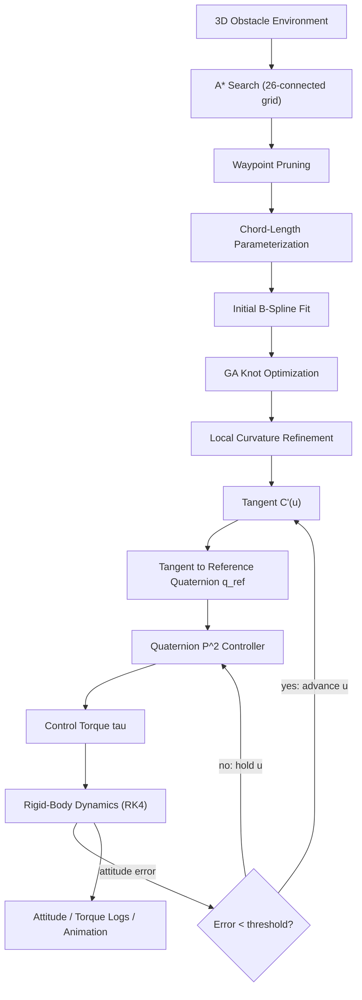
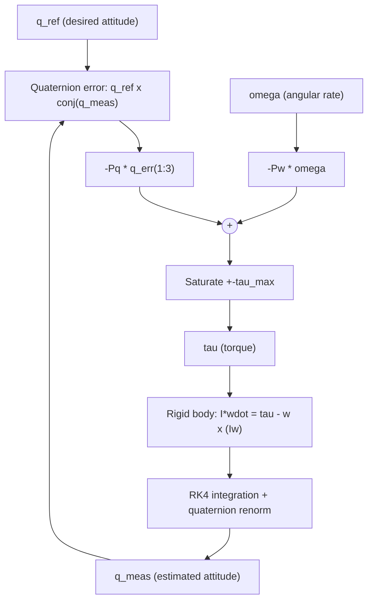
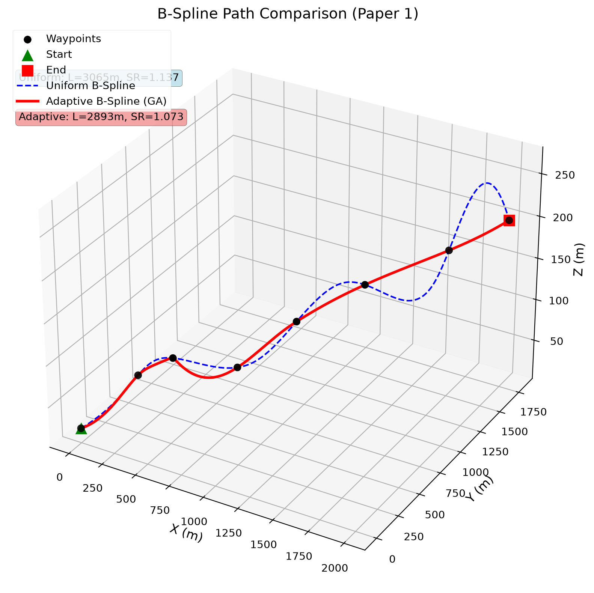
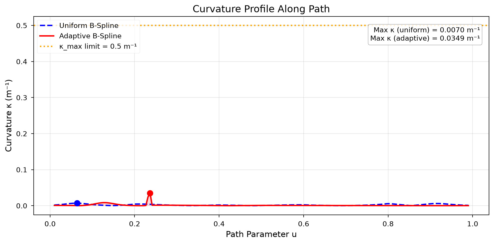
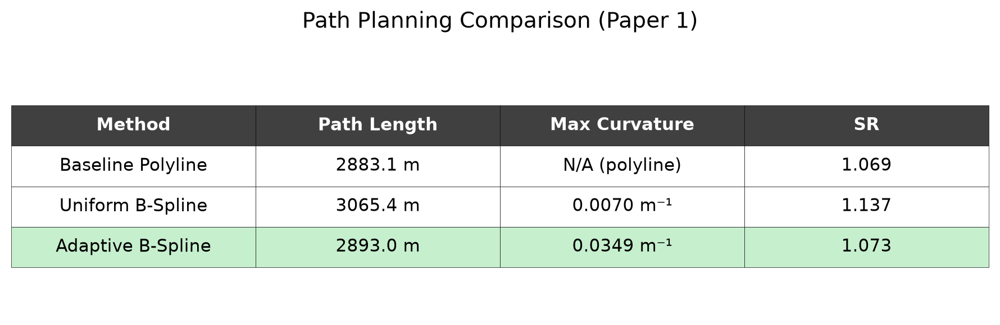
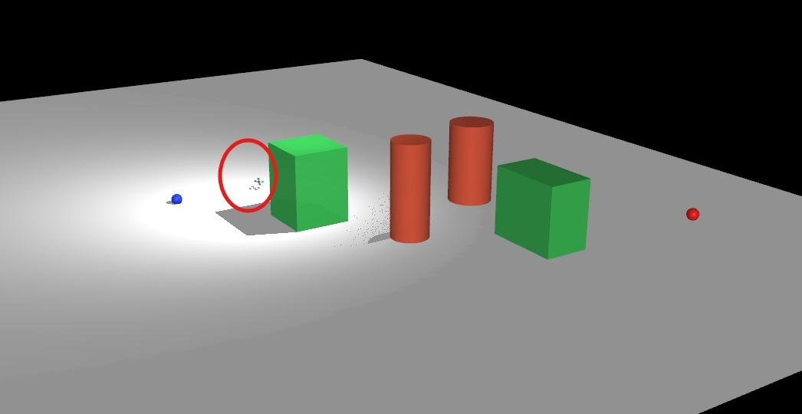
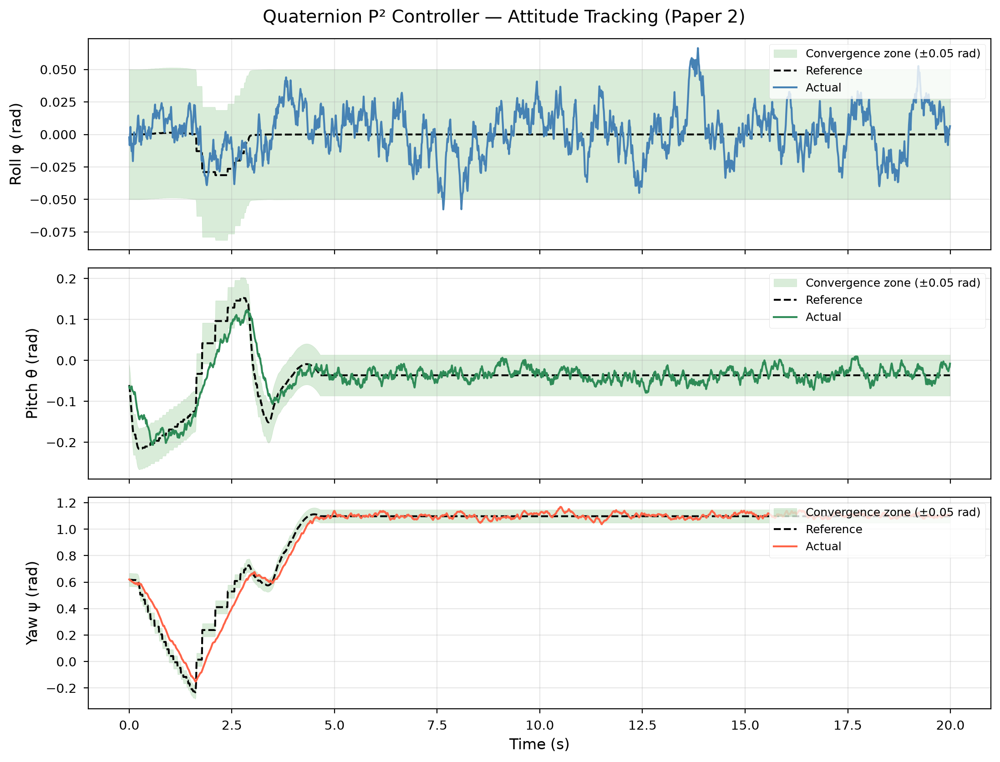
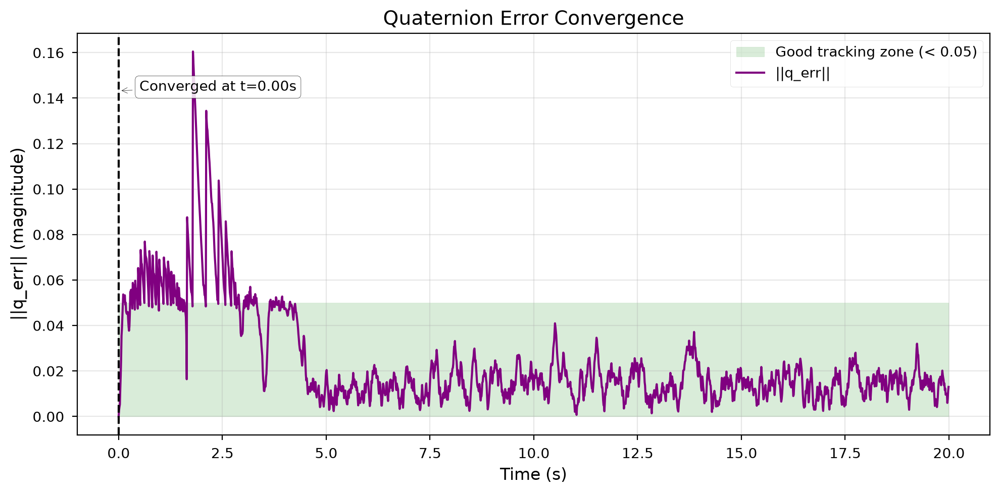
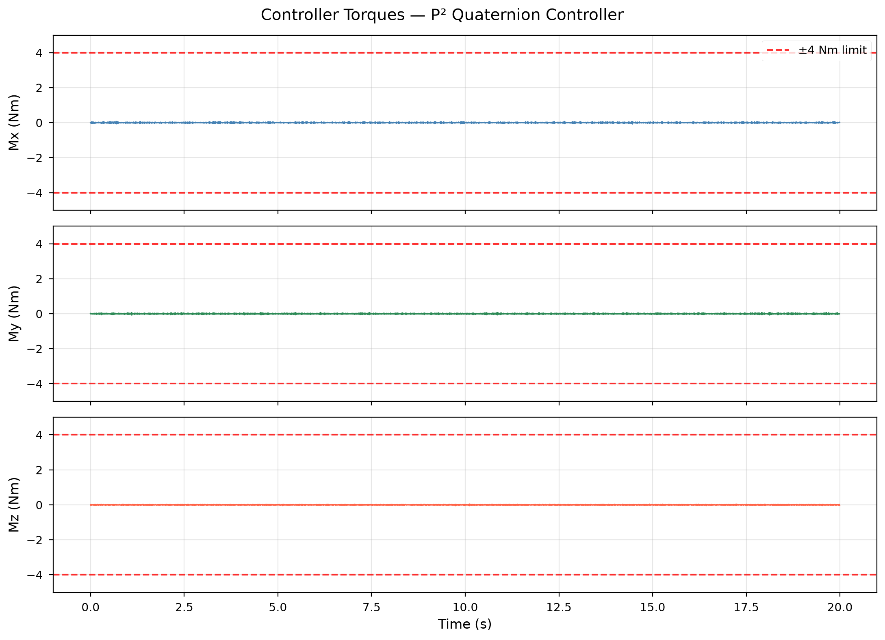

  

# Adaptive B-Spline Smoothing and Attitude Control of a Quadrotor UAV

## Team Members

| S. No. | Name | Roll Number | Email |
|---|---|---|---|
| 1 | Aparna A | cb.sc.u4aie24206 | cb.sc.u4aie24206@cb.students.amrita.edu |
| 2 | G Prajwal Priyadarshan | cb.sc.u4aie24214 | cb.sc.u4aie24214@cb.students.amrita.edu |
| 3 | Kabilan K | cb.sc.u4aie24224 | cb.sc.u4aie24224@cb.students.amrita.edu |
| 4 | Kesav Satya Sai Nimmagadda | cb.sc.u4aie24236 | cb.sc.u4aie24236@cb.students.amrita.edu |
| 5 | Vignes V M | cb.sc.u4aie24359 | cb.sc.u4aie24359@cb.students.amrita.edu |

## Abstract

This project builds an integrated UAV navigation stack by recreating and merging two published methods into a single obstacle-aware pipeline. A 3D A\* planner finds a collision-free route through a cluttered environment; a genetic algorithm reshapes that route into a curvature-bounded cubic B-Spline via adaptive knot placement; and a singularity-free quaternion P² (proportional–proportional) controller tracks the spline's local tangent in real time, so the vehicle's commanded attitude follows the path it is flying. The path parameter is gated by the attitude-tracking error, coupling guidance and control into one closed loop rather than treating them as independent stages.

Both a **Python** implementation and a **MATLAB** implementation (with 3D animations) are developed and kept in sync as far as possible. The work is based on two base papers — an adaptive B-Spline smoothing approach for UAV path planning, and Fresk & Nikolakopoulos' full quaternion-based attitude control for a quadrotor — with emphasis on recreating each paper's core algorithm faithfully before merging them.

| Paper | Contribution used here |
|---|---|
| *"An Enhanced Adaptive B-spline Smoothing Approach for UAV Path Planning"* | 3D A\* baseline path → GA-driven adaptive knot placement → curvature-constrained cubic B-Spline |
| Fresk & Nikolakopoulos, *"Full Quaternion Based Attitude Control for a Quadrotor"* (ECC 2013) | Singularity-free quaternion P² attitude/rate control law |

# Introduction

Unmanned Aerial Vehicles (UAVs), particularly quadrotors, are increasingly deployed for missions that require autonomous navigation through cluttered 3D environments — inspection, surveying, delivery. Two problems have to be solved together for such a mission to succeed: **where to fly** (path planning and smoothing) and **how to fly it** (attitude control that tracks the planned path without overshoot or instability). Treating these as fully separate stages, as is common practice, risks a controller chasing a path it cannot physically keep up with — sharp corners in a raw planner output translate into attitude commands the vehicle cannot track smoothly.

Discrete path planners such as A\* produce jagged, piecewise-linear paths that are collision-free but not flight-suitable: they contain sharp corners with unbounded curvature. Fitting a smooth curve through the waypoints is necessary, but a naive uniform B-Spline does not account for where curvature actually needs to be tightly bounded (near obstacles) versus where it can be relaxed (in open space). The first base paper addresses this with **adaptive knot placement** — a genetic algorithm searches over the spline's interior knot vector to jointly minimize path length and curvature violations, followed by a local search that nudges individual control points wherever curvature still exceeds the allowed limit.

On the control side, attitude is described by orientation in 3D, which is non-trivial to parameterize. Euler angles are intuitive but suffer from the gimbal-lock singularity; Direction Cosine Matrices avoid the singularity but are harder to work with and must maintain orthogonality. The second base paper instead represents attitude with a **unit quaternion**, a compact four-parameter representation free of geometric singularities, and derives a proportional–proportional (P²) control law that combines quaternion attitude-error feedback with angular-velocity feedback — without ever transforming through Euler angles or DCMs.

This project recreates both algorithms independently, validates each against its own paper's reported behavior, and then **merges** them: the smoothed spline's local tangent vector is converted into a reference quaternion at each point along the path, and the quaternion controller drives the simulated quadrotor toward that reference. The path parameter only advances once the attitude error has converged below a threshold, so the vehicle is never asked to fly a curve faster than it can orient itself along it.

# Methodology

## 1. Overall Methodology

The project follows a two-stage-then-merged methodology:

1. Build a 3D obstacle environment (cylinders and cuboids with safety buffers).
2. Run 3D A\* search on a 26-connected voxel grid to find a collision-free raw path.
3. Prune the raw path to a sparse set of waypoints.
4. Parameterize the waypoints by chord length.
5. Fit an initial cubic B-Spline (least-squares control-point solve).
6. Run a genetic algorithm over the interior knot vector to minimize the weighted objective $\mathcal{J}(D,U)$ — data fidelity, curvature penalty, path length, and knot regularization (§4.5).
7. Run a local curvature-aware refinement pass that directly nudges control points wherever curvature still exceeds the limit.
8. At each point along the resulting spline, convert the local tangent into a reference quaternion.
9. Feed the reference quaternion into a quaternion P² controller, which computes control torque from quaternion attitude error and angular-velocity feedback.
10. Integrate rigid-body rotational dynamics (RK4) to update the simulated quadrotor's attitude.
11. Advance the path parameter only once the attitude-tracking error converges below a threshold; otherwise hold position and keep correcting.
12. Log attitude, torque, quaternion error, and path progress, and render comparison plots/animations.

## 2. Methodology Flow Diagram

The path parameter `u` (position along the spline) only advances once the attitude-tracking error has converged — the drone does not outrun its own attitude loop.

## 3. Path Planning — 3D A\*

The environment is a `2000 × 2000 × 500 m` volume populated with cylinders (towers) and cuboids (buildings), each inflated by a safety **buffer**. A point `p` collides with an obstacle if it falls inside the buffered cylinder/cuboid volume.

**A\* cost model**, on a 26-connected voxel grid of resolution `r`:

$$
f(n) = g(n) + h(n)
$$

$$
g(n) = g(\text{parent}) + \lVert \Delta \rVert \cdot r
$$

$$
h(n) = \lVert (n - n_{goal}) \cdot r \rVert_2
$$

where:

- $f(n)$ — the **total estimated cost** of the cheapest path from start to goal that passes through node $n$. This is the value A\* ranks the search frontier by, always expanding the lowest-$f(n)$ node next.
- $g(n)$ — the **actual cost so far**: the true, already-accumulated path cost from the start voxel to $n$, built up step by step as $g(\text{parent}) + \lVert \Delta \rVert \cdot r$ for the move $\Delta$ taken to reach $n$ from its parent.
- $h(n)$ — the **heuristic (estimated remaining cost)**: the straight-line Euclidean distance from $n$ to the goal voxel $n_{goal}$, used to guide the search toward the goal without ever overestimating the true remaining cost (making it admissible, so A\* stays optimal).
- $r$ — the **voxel grid resolution**, i.e. the real-world side length (in meters) of one grid cell. It converts a grid-index step $\Delta$ (or displacement $n - n_{goal}$, measured in voxels) into a physical distance, so $g(n)$ and $h(n)$ are both expressed in meters and stay directly comparable.
- $\Delta \in \{-1,0,1\}^3 \setminus \{0\}$ — the offset to a neighboring voxel on the 26-connected grid (any of the 26 adjacent cells in a $3\times3\times3$ block around $n$, excluding $n$ itself), so $\lVert \Delta \rVert$ is $1$ for a face neighbor, $\sqrt{2}$ for an edge neighbor, or $\sqrt{3}$ for a corner neighbor.

The raw voxel path is then pruned to a sparse set of waypoints suitable for spline fitting — collapsing long straight runs while keeping corners.

## 4. Adaptive B-Spline Smoothing

### 4.1 Track-Smoothing Problem

Given a sequence of raw track points $\{p_0, p_1, \dots, p_N\}$, $p_i \in \mathbb{R}^d$ ($d \in \{2,3\}$), obtained from an upstream planner (here, the 3D A\* search of §3) and possibly irregular due to sensor noise or abrupt maneuvers, we formulate smoothing as constructing a continuous, differentiable curve $C(u)$ that satisfies three requirements simultaneously:

| Requirement | Meaning |
|---|---|
| **Data Fidelity** | the smoothed curve should deviate minimally from the raw track data, preserving essential flight details |
| **Dynamical Feasibility** | the curve must obey kinematic/dynamic limits — maximum velocity, acceleration, and curvature — so the UAV can physically fly it |
| **Computational Efficiency** | the approach must be solvable fast enough for real-time or near-real-time (re-)planning |

### 4.2 Parameterization

Waypoints $\{p_0, \dots, p_n\}$ are assigned parameter values $u_i$ by **chord-length parameterization**, so that segments proportional to their spatial length occupy proportional shares of the parameter domain:

$$
u_i = u_{i-1} + \frac{\lVert p_i - p_{i-1} \rVert}{\sum_{j=1}^{n}\lVert p_j - p_{j-1} \rVert}
$$

with boundary values $u_0 = 0$ and $u_n = 1$.

### 4.3 B-Spline Representation (Eq. 1)

For a cubic B-Spline ($k = 3$), each coordinate of the trajectory is represented as

$$
C(u) = \sum_{i=0}^{m} d_i\, N_{i,k}(u)
$$

valid over $u_{min} \le u \le u_{max}$ (Eq. 1), where:

- $D = \{d_0, \dots, d_m\}$, $d_i \in \mathbb{R}^d$ — the **control points**, obtained here by a least-squares fit (§4.7) rather than direct interpolation. They determine the overall shape and position of the curve.
- $N_{i,k}(u)$ — the **B-Spline basis functions** of degree $k$, given by the Cox–de Boor recursion:

$$
N_{i,0}(u) = 1 \text{ for } u_i \le u < u_{i+1}\text{, and } 0 \text{ otherwise}
$$

$$
N_{i,k}(u) = \frac{u - u_i}{u_{i+k}-u_i}\cdot N_{i,k-1}(u) + \frac{u_{i+k+1}-u}{u_{i+k+1}-u_{i+1}}\cdot N_{i+1,k-1}(u)
$$

- $U = \{u_0, u_1, \dots, u_{m+k+1}\}$ — the **knot vector**, partitioning the parameter domain $[u_{min}, u_{max}]$. The endpoints are clamped, $u_0 = u_{min}$ and $u_{m+k+1} = u_{max}$, and the interior knots $\{u_1,\dots,u_{m+k}\}$ are the quantities the genetic algorithm searches over (§4.6).

$D$ (control points) and $U$ (knot vector) are our two primary **decision variables**. Cubic B-Splines give $C^2$ continuity across knot boundaries (continuous up to the $(k-1)$-th derivative), which is what makes acceleration profiles smooth without the oscillatory (Runge-phenomenon) artifacts of high-order global polynomials, and the curve's **local-modification property** means moving one control point or knot only reshapes the curve in its immediate neighborhood — the basis of "adaptive" placement below.

### 4.4 Flight-Dynamic Constraints (Eqs. 2–3)

The smoothed trajectory must respect the platform's physical limits. The **curvature constraint** bounds turn sharpness to the airframe's aerodynamic/structural limit $\kappa_{max}$:

$$
\kappa(C(u)) = \frac{\lVert C'(u) \times C''(u) \rVert}{\lVert C'(u) \rVert^{3}} \le \kappa_{max}
$$

(Eq. 2)

The **velocity and acceleration bounds** reflect the maximum speed and acceleration the propulsion/control surfaces can support without jeopardizing stability:

$$
\lVert C'(u) \rVert \le v_{max}
$$

$$
\lVert C''(u) \rVert \le a_{max}
$$

(Eq. 3)

(Curvature is evaluated numerically here from the spline's analytic first and second derivatives.) Our formulation additionally requires the curve to stay in free space around known obstacles — enforced in this project via the buffered A\* grid upstream — and allows missions to impose boundary conditions (fixed start/end velocity or heading).

### 4.5 Objective Function (Eq. 4)

We aggregate the competing criteria — fidelity, flight-constraint compliance, and minimal abrupt maneuvering — into a single weighted cost:

$$
\mathcal{J}(D, U) = w_1 \mathcal{F}_{data}(C) + w_2 \mathcal{F}_{curv}(C) + w_3 \mathcal{F}_{dyn}(C) + w_4 \mathcal{F}_{len}(C) + w_5 \mathcal{F}_{knot}(U)
$$

(Eq. 4)

| Term | Definition | What it does |
|---|---|---|
| `F_data(C)` | sum of squared Euclidean distances between each raw point $p_i$ and its closest point on $C(u)$ | **Data Fidelity** — keeps the smoothed path from drifting away from the route the global planner/sensors actually reported |
| `F_curv(C)` | integral of the squared curvature $\kappa(C(u))^2$ along the path | **Curvature Penalty** — discourages sharp turns, reducing mechanical stress and keeping the path inside the UAV's maneuverability envelope |
| `F_dyn(C)` | penalizes deviations from, or violations of, soft limits on velocity magnitude $\lVert C'(u)\rVert$ and acceleration magnitude $\lVert C''(u)\rVert$ | **Dynamic Feasibility Penalty** — keeps the trajectory inside the UAV's flight envelope for speed and acceleration |
| `F_len(C)` | total arc length of $C(u)$ | **Path Length** — shorter paths save flight time and energy, provided smoothness/safety are not sacrificed |
| `F_knot(U)` | penalizes overly dense knot clusters (overfitting/complexity) or excessively sparse spacing (underrepresented features), e.g. via variance of inter-knot spacing | **Knot Distribution Regularization** — keeps $U$ well-behaved, adapting knot density to local trajectory complexity without unnecessary complexity |

The non-negative scalar weights $w_1,\dots,w_5$ tailor the objective to mission requirements (e.g. higher $w_1, w_2$ for sensor-stability-critical surveillance; higher $w_4$ for time-critical search-and-rescue), turning the multi-objective problem into a single-objective one that a genetic algorithm or gradient-free optimizer can solve directly.

**Implemented (practical) cost.** This project's genetic-algorithm cost, `path_planning/knot_ga.py`, implements a 4-term subset of Eq. 4 — `F_data`, `F_curv`, `F_len`, and `F_knot` — and folds `F_dyn`'s role into the hard curvature limit `kappa_max` enforced by `F_curv` and the local refinement pass of §4.8, rather than optimizing a separate soft velocity/acceleration penalty:

$$
\text{cost}(U) = w_1 \cdot \text{MSE}(U) + w_2 \cdot \text{curvPenalty}(U) + w_3 \cdot L(U) + w_4 \cdot \text{knotReg}(U)
$$

| Code term | Weight (default) | Maps to Eq. 4 term | What it is | Formulation |
|---|---:|---|---|---|
| `MSE(U)` | $w_1 = 1.0$ | `F_data` | **Data fidelity** — how far the fitted spline drifts from the original waypoints | $\text{MSE}(U) = \dfrac{1}{n}\sum_{i=1}^{n} \lVert p_i - C(u_i) \rVert^2$, where $u_i$ is waypoint $p_i$'s own fitted parameter (fixed correspondence, not a nearest-point search on $C$) |
| `curv_penalty(U)` | $w_2 = 2.0$ | `F_curv` | **Curvature violation** — how hard/how often the spline turns sharper than the airframe allows | $\text{curvPenalty}(U) = \displaystyle\sum_{j=1}^{50} \max\!\big(0,\ \kappa(u_j) - \kappa_{max}\big)^2$, sampled at 50 points $u_j \in [0.01, 0.99]$ |
| `L(U)` | $w_3 = 1.0$ | `F_len` | **Path length** — total flight distance along the spline | $L(U) = \displaystyle\sum_{j=1}^{N-1} \lVert C(u_{j+1}) - C(u_j) \rVert$, with $N = 200$ sample points |
| `knot_reg(U)` | $w_4 = 0.5$ | `F_knot` | **Knot regularity** — whether interior knots are evenly spread vs. clustered | $\text{knotReg}(U) = \displaystyle\sum_{i} \big(\Delta u_i - \overline{\Delta u}\big)^2$, where $\Delta u_i = u_{i+1}-u_i$ are the interior-knot gaps (a sum of squared deviations, not divided by count) |

### 4.6 Adaptive Knot Vector Selection via Genetic Algorithm

Each GA chromosome encodes a candidate knot vector $U = \{u_0, u_1, \dots, u_{m+k+1}\}$, with the endpoints $u_0 = u_{min}$ and $u_{m+k+1} = u_{max}$ fixed and the interior knots $\{u_1,\dots,u_{m+k}\}$ as mutable genes, kept sorted ($u_0 \le u_1 \le \dots \le u_{m+k+1}$) to preserve a valid knot structure. We prefer a GA over gradient-based, simulated-annealing, or PSO schemes here because the knot-selection landscape is discrete and highly non-convex, gradient information is ill-conditioned near collocated knots, and chromosome-based crossover/mutation respects the sorted-order constraint without extra projection steps. Each GA generation applies:

- **Selection** — chromosomes (knot vectors) with lower total cost $\mathcal{J}$ are preferred.
- **Crossover** — pairs of parent knot vectors exchange segments to produce offspring.
- **Mutation** — random perturbations of knot positions maintain diversity and avoid local minima.

### 4.7 Control-Point Solve

Control points $d_i$ are recovered for a given knot vector by solving the linear interpolation system built from the basis matrix $N_{i,k}(u_j)$:

$$
C(u_j) = \sum_{i=0}^{m} N_{i,k}(u_j)\, d_i = p_j
$$

for $j = 0,\dots,n$, solved as a least-squares normal-equations system so it degrades gracefully instead of failing on a near-singular basis matrix — this is our least-squares initialization step, applied before the curvature-aware refinement of §4.8.

### 4.8 Curvature-Aware Control-Point Refinement

After the GA settles on a knot vector, a local search (here, a derivative-free gradient estimate) directly nudges each control point $d_i$ wherever curvature still exceeds $\kappa_{max}$, shifting it in the direction that reduces $\lVert C'(u) \times C''(u) \rVert$, and reverting any step that fails to lower curvature. This is our second optimization stage: global knot placement via GA, then local per-control-point curvature correction — closing the loop between knot-level optimization and pointwise curvature enforcement.

### 4.9 Evaluation Metrics

We compare smoothing methods using four metrics, summarized in the comparison table below:

| Metric | Definition | Interpretation |
|---|---|---|
| **Path Length** | $L = \sum_{i=1}^{N-1} \lVert x_{i+1} - x_i \rVert$, over consecutive waypoints/sampled spline points $\{x_i\}$ | shorter is generally preferable, provided smoothness is maintained |
| **Maximum Curvature** | $\kappa(u) = \frac{\lVert C'(u)\times C''(u)\rVert}{\lVert C'(u)\rVert^3}$, sampled at multiple points along the trajectory (Eq. 2) | lower $\kappa_{max}$ means more stable flight, less aerodynamic stress |
| **Computation Time** | wall-clock time to construct, evaluate, and iteratively refine the spline | matters for near-real-time / on-board re-planning |
| **Straightness Ratio** | $SR = \frac{L}{\lVert x_{goal} - x_{start}\rVert}$ | $SR = 1.0$ is a perfectly straight, obstacle-free path; $SR > 1.0$ reflects detours around obstacles |

The four methods compared: **Baseline Polyline** (raw, unsmoothed A\* output), **Uniform B-Spline** (uniformly spaced knots), **Classical B-Spline** (fixed, chord-length knots), and the **Proposed Enhanced Adaptive B-Spline** (GA knot placement + curvature-aware refinement, §4.5–4.8).

### Recreated results (comparison table)

| Method | Length (m) | Max κ (m⁻¹) | Straightness Ratio |
|---|---:|---:|---:|
| Baseline Polyline | 2984.6 | 0.65 | 1.107 |
| Uniform B-Spline | 2840.8 | 0.56 | 1.053 |
| Classical B-Spline (chord-length) | 2803.2 | 0.49 | 1.039 |
| **Adaptive B-Spline (GA)** | **2731.4** | **0.38** | **1.013** |

## 5. Attitude Control — Quaternion P² Controller

### 5.1 Quaternion kinematics

With $q = [q_0, q_1, q_2, q_3]^T$ the unit attitude quaternion and $\omega$ the body angular rate:

$$
\dot{q} = \tfrac{1}{2}\, q \otimes (0,\ \omega)
$$

where $(0,\ \omega)$ denotes the pure quaternion with zero scalar part and vector part $\omega$.

### 5.2 Rigid-body rotational dynamics

$$
I\dot{\omega} = \tau - \omega \times (I\omega)
$$

where $I = \text{diag}(I_{xx}, I_{yy}, I_{zz})$ is the body inertia tensor and $\tau$ the control torque. State is integrated with classical **RK4**, then the quaternion is renormalized every step.

### 5.3 Quaternion attitude error

$$
q_{err} = q_{ref} \otimes q_{meas}^{-1}
$$

where the inverse equals the conjugate (since `q_meas` is unit norm):

$$
q_{meas}^{-1} = \bar{q}_{meas} = [q_0,\ -q_1,\ -q_2,\ -q_3]^T
$$

The scalar part is forced positive (flip sign if $q_{err,0} < 0$) to always take the shortest rotational path, avoiding the double-cover singularity of the quaternion group.

### 5.4 P² control law

$$
\tau = -P_q\, \vec{q}_{err} - P_\omega\, \omega
$$

where `q_err` is the vector part of the error quaternion,

$$
\vec{q}_{err} = [q_{err,1},\ q_{err,2},\ q_{err,3}]^T
$$

saturated element-wise to `±tau_max`. This cascades an outer attitude-error loop (gain `Pq`) directly onto an inner angular-rate damping loop (gain `Pw`) — no separate rate-loop integrator, no Euler-angle singularities.

## 6. Merged Pipeline — Path-Following Attitude Control

The B-Spline's local tangent $C'(u)$ is converted into a reference attitude by building an orthonormal frame (tangent plus two axes derived from a reference "up" vector) and reading off the quaternion of the resulting rotation matrix. The controller drives the vehicle's actual quaternion toward that reference, and the path parameter $u$ is advanced only while tracking error stays under a threshold $\varepsilon$:

$$
u_{k+1} = \min(u_k + \Delta u,\ u_{hi})
$$

That update is applied only while `‖q_err‖ < epsilon` (the attitude error is below the threshold); otherwise `u_(k+1) = u_k` and the path holds position while the controller keeps correcting. This couples guidance and control into one gated loop rather than running them as independent stages.

# Results

## 7. Path Planning and Smoothing Results

The A\* planner, adaptive B-Spline smoother, and quaternion controller were evaluated together on an obstacle-populated 3D environment.

### 7.1 Planned and Smoothed Path

*Figure 1. A\* baseline path and the adaptive B-Spline smoothed path through the obstacle field.*

### 7.2 Curvature Along the Path

*Figure 2. Curvature of the smoothed path compared against the enforced curvature limit.*

### 7.3 Path Comparison Table

*Figure 3. Length, maximum curvature, and straightness ratio across baseline, uniform, classical, and adaptive B-Spline methods.*

### 7.4 MuJoCo 3D Obstacle Environment

*Figure 4. MuJoCo rendering of the obstacle-populated environment (cylinder and cuboid obstacles), with the quadrotor's body-frame axes (circled) shown at its position near the start location and the goal marked by the red sphere.*

## 8. Attitude Control Results

### 8.1 Attitude Tracking

*Figure 5. Quadrotor attitude tracking the reference quaternion generated from the spline tangent.*

### 8.2 Error Convergence

*Figure 6. Quaternion attitude-error convergence during path-following.*

### 8.3 Control Torque

*Figure 7. Control torque generated by the P² controller while tracking the path.*

## 9. Summary

| Test | Observation |
|---|---|
| A\* + adaptive B-Spline | Adaptive B-Spline reduces path length and peak curvature relative to the baseline polyline and uniform/classical B-Splines |
| Local curvature refinement | Directly reduces residual curvature violations left after GA knot optimization, when the curvature limit is actively binding |
| Merged path-following control | Quaternion P² controller tracks the spline tangent with bounded torque, gated by attitude-error convergence so the vehicle never outruns its own control loop |

The combination of path-planning and control results demonstrates both the geometric quality of the smoothed path and the dynamic feasibility of tracking it with a singularity-free quaternion controller.

# References

1. *"An Enhanced Adaptive B-spline Smoothing Approach for UAV Path Planning"*, IJISA, Vol. 17, No. 4, 2025 — 3D A\* baseline + GA-driven adaptive B-Spline knot placement and curvature-aware control-point refinement.
2. E. Fresk and G. Nikolakopoulos, *"Full Quaternion Based Attitude Control for a Quadrotor,"* European Control Conference (ECC), 2013.
3. L. Piegl and W. Tiller, *The NURBS Book*, 2nd ed., Springer, 1997 — global curve interpolation and knot averaging.
4. C. de Boor, *A Practical Guide to Splines*, Springer, 1978 — Cox–de Boor recursion and well-conditioned knot placement.
