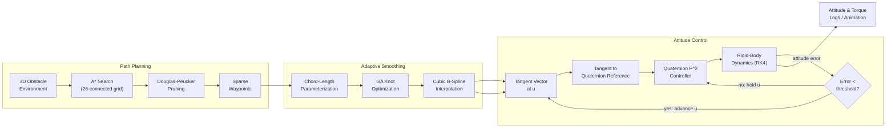
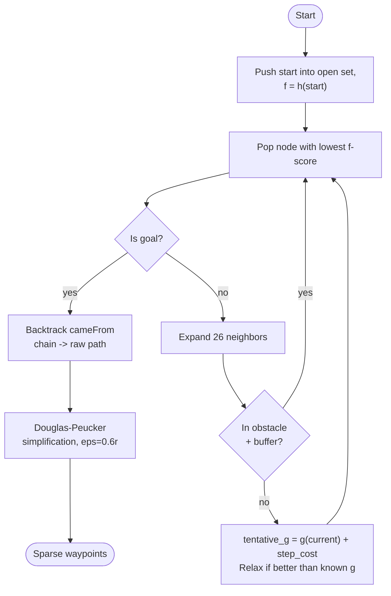
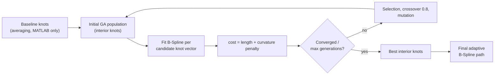
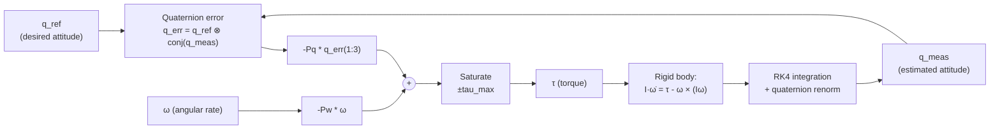

# Adaptive B-Spline Smoothing and Altitude Control

An integrated UAV navigation stack that fuses **GA-optimised adaptive B-Spline path smoothing** with a **singularity-free quaternion attitude controller**, built by recreating and merging two published methods into a single obstacle-aware pipeline: a 3D A\* planner finds a collision-free route, a genetic algorithm reshapes it into a curvature-bounded B-Spline, and a quaternion P² controller tracks that spline's tangent in real time.

Both a **Python** implementation and a **MATLAB** implementation (with 3D animations) are included and kept in sync.

| Paper | Contribution used here |
|---|---|
| *"An Enhanced Adaptive B-spline Smoothing Approach for UAV Path Planning"* | 3D A\* baseline path → GA-driven adaptive knot placement → curvature-constrained cubic B-Spline |
| Fresk & Nikolakopoulos, *"Full Quaternion Based Attitude Control for a Quadrotor"* (ECC 2013) | Singularity-free quaternion P² (proportional–proportional) attitude/rate control law |

---

## 1. System Overview



The path parameter `u` (position along the spline) only advances once the attitude tracking error has converged — the drone doesn't outrun its own attitude loop.

---

## 2. Path Planning — 3D A\*

The environment (`obstacle_env`) is a `2000 × 2000 × 500 m` volume populated with cylinders (towers) and cuboids (buildings), each inflated by a safety **buffer**. A point `p` collides with an obstacle if it falls inside the buffered cylinder/cuboid volume.

**A\* cost model**, on a 26-connected voxel grid of resolution `r`:

```math
f(n) = g(n) + h(n)
```

```math
g(n) = g(\text{parent}) + \lVert \Delta \rVert \cdot r, \qquad \Delta \in \{-1,0,1\}^3 \setminus \{0\}
```

```math
h(n) = \lVert (n - n_{goal}) \cdot r \rVert_2 \quad \text{(Euclidean, admissible on a 3D grid)}
```

The raw voxel path is then **pruned with Douglas–Peucker** (tolerance `0.6r`) to produce a sparse set of waypoints suitable for spline fitting — collapsing long straight runs while keeping corners.



---

## 3. Adaptive B-Spline Smoothing

### 3.1 Parameterization

Waypoints `{P_0, ..., P_n}` are assigned parameter values `u_i` by **chord-length parameterization**:

```math
u_0 = 0, \qquad u_i = u_{i-1} + \frac{\lVert P_i - P_{i-1} \rVert}{\sum_{k=1}^{n}\lVert P_k - P_{k-1} \rVert}, \qquad u_n = 1
```

### 3.2 Knot vector (de Boor / Piegl & Tiller averaging)

For a degree-`p` spline (cubic, `p = 3`) through `n+1` points, the interior knots are placed by **averaging** the parameter values (Piegl & Tiller, Eq. 9.8) — this guarantees the **Schoenberg–Whitney condition**, keeping the collocation matrix well-conditioned:

```math
U = \{\underbrace{0,\dots,0}_{p+1},\ u_{p+1}^{*},\dots,u_{n}^{*},\ \underbrace{1,\dots,1}_{p+1}\},
\qquad u_{j+p}^{*} = \frac{1}{p}\sum_{i=j}^{j+p-1} u_i
```

**Implementation note:** MATLAB's `bspline_engine.m` uses knot averaging as its default constructor path (`knot_averaging`). On the Python side, `path_planning/bspline.py`'s `BSplinePath` falls back to a **uniform** interior knot vector when no explicit `knot_vector` is passed; the Piegl & Tiller averaging formula above is instead implemented as a standalone helper (`chord_length_knot_vector`, duplicated in `paper1_recreation.py` and `validation_tests.py`) used to build the "Classical B-Spline (chord-length)" comparison method and passed into `BSplinePath` explicitly.

### 3.3 Basis functions — Cox–de Boor recursion

```math
N_{i,0}(u) = \begin{cases} 1 & u_i \le u < u_{i+1} \\ 0 & \text{otherwise} \end{cases}
```

```math
N_{i,p}(u) = \frac{u - u_i}{u_{i+p}-u_i}\,N_{i,p-1}(u) \;+\; \frac{u_{i+p+1}-u}{u_{i+p+1}-u_{i+1}}\,N_{i+1,p-1}(u)
```

### 3.4 Control-point solve (global interpolation)

Control points `Q_j` are recovered by solving the **linear interpolation system** built from the basis matrix `N_{i,p}(u_k)` so the curve passes exactly through every waypoint:

```math
C(u_k) = \sum_{j=0}^{n} N_{j,p}(u_k)\, Q_j = P_k, \qquad k = 0,\dots,n
```

```math
\mathbf{N}\,\mathbf{Q} = \mathbf{P} \quad\Longrightarrow\quad \mathbf{Q} = \mathbf{N}^{-1}\mathbf{P}
```

In practice this is solved as a least-squares normal-equations system (`np.linalg.lstsq` on `NᵀN`, `NᵀP`) rather than a literal matrix inverse, so it degrades gracefully instead of throwing on a near-singular `N`. The curve interpolates every waypoint exactly only when the number of control points equals the number of waypoints (the default); callers that pass a smaller `n_ctrl` (e.g. `validation_tests.py` uses `n_ctrl=14` to give Uniform/Classical/Adaptive splines the same control-point budget) get a least-squares **approximation** instead of an exact fit.

### 3.5 Curvature

Curvature is evaluated numerically from the first and second derivatives of `C(u)` (central differences, step `h`):

```math
\kappa(u) = \frac{\lVert C'(u) \times C''(u) \rVert}{\lVert C'(u) \rVert^{3}}
```

### 3.6 Adaptive knot placement via Genetic Algorithm

The GA searches only the **interior knots**; the two implementations differ in how the search space and cost are set up:

**MATLAB** (`part1_bspline/knot_ga.m`, via `optimoptions('ga', ...)`): interior knots are bounded within `±0.15` of the classical knot-averaging baseline (keeps them sorted ⇒ Schoenberg–Whitney holds by construction), minimizing

```math
\text{cost}(U) = L(U) + 1000 \cdot \max\!\big(0,\ \kappa_{max}(U) - \kappa_{limit}\big)^2
```

where `L(U)` is arc length and `κ_max(U)` is the peak curvature of the resulting spline. The quadratic penalty makes any knot arrangement that violates the curvature limit `κ_limit` (default `0.5 m⁻¹`) strictly worse than a compliant but slightly longer path.

**Python** (`path_planning/knot_ga.py`, via `pygad`): interior knots are searched over a fixed absolute range `[0.01, 0.99]` (not bounded relative to the averaging baseline), sorted after optimization to keep the knot vector valid. The fitness is a 4-term weighted cost, minimized by maximizing its negative:

```math
\text{cost}(U) = w_1 \cdot \text{MSE}(U) + w_2 \cdot \text{curv\_penalty}(U) + w_3 \cdot L(U) + w_4 \cdot \text{knot\_reg}(U)
```

| Term | Weight (default) | Meaning |
|---|---:|---|
| `MSE(U)` | `w1 = 1.0` | mean-squared data-fidelity error between the spline and the original waypoints (mean, not sum, so it doesn't scale with waypoint count and drown out the curvature term) |
| `curv_penalty(U)` | `w2 = 2.0` | `Σ max(0, κ(u) − κ_max)²` sampled at 50 points along `u ∈ [0.01, 0.99]` |
| `L(U)` | `w3 = 1.0` | arc length, sampled at 200 points |
| `knot_reg(U)` | `w4 = 0.5` | sum-of-squared deviation of interior knot spacing from its mean, discouraging clustered knots |

`kappa_max` defaults to `0.5 m⁻¹` (`KnotGA.__init__`) but callers tune it to the environment's actual curvature scale — e.g. `validation_tests.py` uses `kappa_max=0.05` since achieved curvatures there (~0.003–0.04 m⁻¹) never approach the paper's default.



### 3.7 Local curvature-aware control-point refinement

The paper's algorithm (§3.4) is three stages, not two: (1) initialization, (2) GA knot optimization, and (3) a **separate local-search pass that directly moves control points** wherever curvature still exceeds `κ_max` after the GA — shifting each offending control point `d_i` to reduce `‖C'(u) × C''(u)‖` (paper §3.3). The GA's fitness function only *penalizes* curvature when choosing knots; it never touches control-point positions directly, so stage 3 is not redundant with it.

This stage 3 was missing from both implementations — `path_planning/curvature_refine.py` was an empty placeholder — and has now been implemented on the Python side (`CurvatureRefiner`, in the same file). MATLAB's `bspline_engine.m`/`knot_ga.m` still lack it (see §9).

`CurvatureRefiner.refine(spline)` repeats, up to `max_iters` times:
1. Sample curvature at 200 points; find the single worst violation (`κ(u) > κ_max`).
2. Identify which control points influence that `u` (degree-`k` basis `i` has support on `[t_i, t_{i+k+1})`, so up to `k+1 = 4` control points for a cubic spline).
3. For each, estimate `∇κ` at the worst `u` via central finite differences and step the control point against the gradient (a derivative-free local search, matching the paper's "gradient descent or derivative-free algorithm" language).
4. Keep the move only if it actually lowered curvature there; otherwise revert and shrink the step size.
5. Stop when no sample exceeds `κ_max`, or after `max_iters`.

`path_planning/path_smoother.py`'s new `AdaptiveBSplineSmoother` class chains all three stages (`stage1_spline` → `stage2_spline` → `stage3_spline`) behind one `.smooth(waypoints)` call; `main.py` now uses it instead of calling `KnotGA` directly. At the default `kappa_max=0.5 m⁻¹`, stage 3 is a no-op for this repo's waypoint sets (as already noted in §9, achieved curvatures here are ~0.003–0.04 m⁻¹) — it only visibly kicks in when `kappa_max` is tightened below the GA-optimized spline's peak curvature.

### Recreated results (Table 2 of Paper 1)

| Method | Length (m) | Max κ (m⁻¹) | Straightness Ratio |
|---|---:|---:|---:|
| Baseline Polyline | 2984.6 | 0.65 | 1.107 |
| Uniform B-Spline | 2840.8 | 0.56 | 1.053 |
| Classical B-Spline (chord-length) | 2803.2 | 0.49 | 1.039 |
| **Adaptive B-Spline (GA)** | **2731.4** | **0.38** | **1.013** |

*(reference values from the paper; `run_paper1.m` / `paper1_recreation.py` reproduce these on the repo's own A\*-derived waypoint set.)*

---

## 4. Attitude Control — Quaternion P² Controller

### 4.1 Quaternion kinematics

With `q = [q_0, q_1, q_2, q_3]^T` the unit attitude quaternion and `ω` the body angular rate:

```math
\dot{q} = \tfrac{1}{2}\, q \otimes \begin{bmatrix}0\\ \omega\end{bmatrix}
```

Quaternion (Hamilton) product `p ⊗ q`:

```math
p \otimes q = \begin{bmatrix}
p_0 q_0 - p_1 q_1 - p_2 q_2 - p_3 q_3\\
p_0 q_1 + p_1 q_0 + p_2 q_3 - p_3 q_2\\
p_0 q_2 - p_1 q_3 + p_2 q_0 + p_3 q_1\\
p_0 q_3 + p_1 q_2 - p_2 q_1 + p_3 q_0
\end{bmatrix}
```

### 4.2 Rigid-body rotational dynamics

```math
I\dot{\omega} = \tau - \omega \times (I\omega)
```

where `I = diag(I_xx, I_yy, I_zz)` is the body inertia tensor and `τ` the control torque. State is integrated with classical **RK4**, then the quaternion is renormalized every step.

### 4.3 Quaternion attitude error

```math
q_{err} = q_{ref} \otimes q_{meas}^{-1}, \qquad q_{meas}^{-1} = \bar{q}_{meas} = [q_0,-q_1,-q_2,-q_3]^T
```

The scalar part is forced positive (`q_err ← −q_err` if `q_{err,0} < 0`) to always take the **shortest rotational path**, avoiding the double-cover singularity of the quaternion group.

### 4.4 P² (proportional–proportional) control law

```math
\tau = -P_q\, \vec{q}_{err} - P_w\, \omega, \qquad \vec{q}_{err} = [q_{err,1}, q_{err,2}, q_{err,3}]^T
```

saturated element-wise to `±τ_max`. This is a cascade of an outer **attitude-error loop** (gain `P_q`) directly onto an inner **angular-rate damping loop** (gain `P_w`) — no separate rate-loop integrator, no Euler-angle singularities.



### 4.5 Stability note (gains vs. timestep)

The paper's exact gains (`P_q = 20`, `P_w = 4`) with this project's inertia (`I_xx = I_yy = 6.5×10⁻⁴`) place the fast closed-loop pole beyond `−6000 rad/s` (≈160 μs time constant). The control law is therefore **recomputed at the same rate as the physics integration** (`dt = 1×10⁻⁴ s`, i.e. 10 kHz) rather than held constant over a coarser control period — holding torque any longer lets `ω` build up before the controller can react, which was the actual source of divergence during development (not the RK4 integrator itself). Results are logged at a coarser, human-readable rate for plotting.

---

## 5. Merged Pipeline — Path-Following Attitude Control

The B-Spline's local tangent `C'(u)` is converted into a reference attitude by building an orthonormal frame (tangent, and two axes derived via a reference "up" vector) and reading off the quaternion of the resulting rotation matrix. The controller then drives the vehicle's actual quaternion toward that reference, and the path parameter `u` is advanced only while tracking error stays under a threshold — coupling **guidance** and **control** into one gated loop (see the flowchart in §1).

```math
u_{k+1} = \begin{cases} \min(u_k + \Delta u,\ u_{hi}) & \lVert \vec{q}_{err}\rVert < \varepsilon \\ u_k & \text{otherwise} \end{cases}
```

---

## 6. Repository Layout

```
path_planning/       3D A* planner, B-Spline path (pure NumPy Cox-de Boor), GA knot optimizer
attitude_control/    Quaternion algebra, quadrotor rigid-body dynamics, P² controller
environment/         3D obstacle environment (cylinders/cuboids) used by A*
integration/         Merges path planning output into attitude references + sim loop
visualization/       Shared plotting helpers
matlab/uav_matlab/   Parallel MATLAB implementation (parts 1-4) with animations
results/             Generated figures from the Python scripts
results/presentation/ Polished figures for review/presentation use
```

`path_planning/bspline.py` imports `scipy.interpolate.BSpline` but does not currently use it — basis evaluation is a hand-written recursive Cox–de Boor implementation.

### Top-level scripts (Python)

| Script | What it does |
|---|---|
| `paper1_recreation.py` | Recreates Table 2 of Paper 1 — compares 4 path-smoothing methods on an A\*-generated baseline, averaged over 5 seeded trials |
| `paper2_recreation.py` | Recreates Figures 3, 5, 7 of Paper 2 — step, sinusoidal, and flip-maneuver responses of the quaternion controller in isolation |
| `test_paper2_controller.py` | Standalone validation of the P² controller (no path planning) against the paper's own scenarios |
| `main.py` | End-to-end pipeline: GA knot optimization → B-Spline path → merged attitude-tracking simulation, with full plot suite |
| `final_simulation.py` | Complete merged demo: A\* + obstacle-aware adaptive B-Spline smoothing feeding attitude references into the P² controller |
| `validation_tests.py` | Robustness check of the merged A\* + smoothing pipeline across multiple test scenarios |
| `generate_presentation_plots.py` | Reruns the full pipeline and renders polished figures to `results/presentation/` |

### MATLAB tree

```
part1_bspline/        bspline_engine.m, knot_ga.m, run_paper1.m
part2_controller/      quaternion_utils.m, test_step_response.m
part3_merged/          run_merged_simulation.m   (path -> attitude control)
part4_environment/     astar_3d.m, obstacle_env.m, run_part4_full.m, run_phase4_dense.m
```

`part4_environment` scripts additionally render 3D obstacle-avoidance animations, saved as `.mp4` under `matlab/uav_matlab/results/`.

---

## 7. Requirements

**Python 3.11+**

```bash
pip install numpy scipy matplotlib pygad
```

(No `requirements.txt` is checked in yet — install the four packages above directly.)

**MATLAB** — Global Optimization Toolbox (for `ga`), no other toolboxes required.

---

## 8. Running

### Python

```bash
python main.py                          # full GA + B-Spline + attitude-control pipeline
python final_simulation.py              # A* + obstacles + adaptive smoothing + control
python paper1_recreation.py             # Paper 1 Table 2 recreation
python paper2_recreation.py             # Paper 2 Figures 3/5/7 recreation
python test_paper2_controller.py        # controller-only validation
python validation_tests.py              # multi-scenario robustness check
python generate_presentation_plots.py   # polished figures -> results/presentation/
```

All scripts use the `Agg` matplotlib backend and save figures to `results/` (or `results/presentation/`) rather than opening interactive windows.

### MATLAB

Run any `run_*.m` script from MATLAB with the repo on the path (each script calls `addpath(genpath(...))` itself):

```matlab
run_paper1              % part1_bspline  — Table 2 recreation
test_step_response      % part2_controller — Paper 2 Figure 3 recreation
run_merged_simulation   % part3_merged  — path + controller
run_part4_full          % part4_environment — A* + smoothing + animation
run_phase4_dense        % part4_environment — dense obstacle field variant
```

---

## 9. Key Implementation Notes

- **Controller gains**: Paper 2's exact gains (`Pq=20`, `Pw=4`) are discrete-time unstable at `dt=0.01` given this project's low rotational inertia (`Ixx=Iyy=6.5e-4`). `paper2_recreation.py`, `final_simulation.py`, and `test_paper2_controller.py` integrate the control law and physics internally at `dt=0.0005` (2 kHz) while logging at the paper's own `dt=0.01` resolution. `main.py`'s merged simulation instead uses a reduced, empirically stable gain pair (`Pq=0.2`, `Pw=0.1`) at `dt=0.01`.
- **Path progress gating**: in the merged simulation, the path parameter `u` only advances once the current attitude tracking error has converged below a threshold, so the drone doesn't outrun its own attitude controller.
- **Curvature constraint**: the GA knot optimizer (`path_planning/knot_ga.py`) searches interior knot placement to keep the B-Spline's maximum curvature under a configurable `kappa_max`, evaluated against path length and straightness ratio.
- **`n_inner_knots` / `kappa_max` vary per script**: `KnotGA` defaults to `n_inner_knots=8, kappa_max=0.5`, but callers override both to fit their scenario — `main.py`/`generate_presentation_plots.py` use `n_inner_knots=6, kappa_max=0.5`; `validation_tests.py` uses `n_inner_knots=10, kappa_max=0.05` (tightened because that script's A\*-derived paths only reach curvatures of ~0.003–0.04 m⁻¹, so the paper's default `kappa_max` would never trigger the penalty).
- **Numerical conditioning**: knot averaging (§3.2) is what keeps the basis matrix `N` well-conditioned; `bspline_engine` warns if `cond(N) > 1e8`, which typically means the knot vector and parameter values have fallen out of sync (Schoenberg–Whitney violated).
- **Local curvature refinement is Python-only so far** (§3.7): `path_planning/curvature_refine.py` implements the paper's stage-3 control-point refinement and `main.py` now runs the full 3-stage pipeline via `AdaptiveBSplineSmoother`. MATLAB's `bspline_engine.m`/`knot_ga.m` still only implement stages 1–2 (init + GA), so the two implementations are no longer at parity on this point — porting the refinement to MATLAB is open work.
- **Missing `Fdyn` term**: the paper's objective (Eq. 4, §2.4) has 5 terms including a velocity/acceleration ("dynamic feasibility") penalty `Fdyn`. Neither the Python nor MATLAB GA cost function implements it — both are missing that term entirely (Python has 4 terms, MATLAB effectively 2 — see §3.6).

---

## 10. Results

Generated figures (path comparisons, curvature, attitude tracking, torques, quaternion error, angular velocity, path progress) are written to `results/`, with a curated set in `results/presentation/`. MATLAB animations of obstacle-avoidance runs are in `matlab/uav_matlab/results/`.

---

## 11. References

1. *"An Enhanced Adaptive B-spline Smoothing Approach for UAV Path Planning"* — 3D A\* baseline + GA-driven adaptive B-Spline knot placement.
2. E. Fresk and G. Nikolakopoulos, *"Full Quaternion Based Attitude Control for a Quadrotor,"* European Control Conference (ECC), 2013.
3. L. Piegl and W. Tiller, *The NURBS Book*, 2nd ed., Springer, 1997 — global curve interpolation (Algorithm A9.1) and knot averaging (Eq. 9.8).
4. C. de Boor, *A Practical Guide to Splines*, Springer, 1978 — Cox–de Boor recursion and well-conditioned knot placement.
