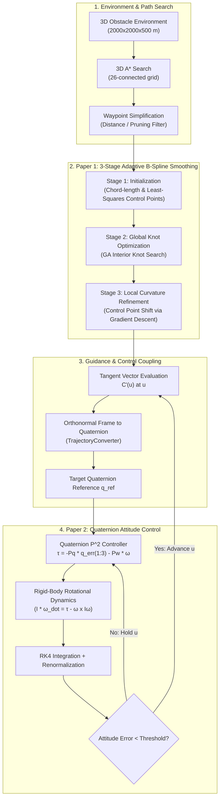

# Comprehensive Technical Documentation: Adaptive B-Spline Path Smoothing and Altitude/Attitude Control Stack

## Executive Summary

This repository presents an end-to-end UAV navigation and attitude control stack. It fuses **GA-optimized adaptive B-Spline path smoothing** with a **singularity-free quaternion attitude controller** by recreating, enhancing, and integrating two published control and path-planning frameworks:

1. **Paper 1 (Path Planning & Smoothing)**: Nikolaiev & Novotarskyi, *"An Enhanced Adaptive B-spline Smoothing Approach for UAV Path Planning"*, IJISA, Vol. 17, No. 4, 2025.
2. **Paper 2 (Attitude Control)**: Fresk & Nikolakopoulos, *"Full Quaternion Based Attitude Control for a Quadrotor"*, European Control Conference (ECC), 2013.

The architecture connects path generation with quadrotor dynamics through a **gated guidance loop**, where local path tangent vectors drive target quaternions, and path progress ($u$) only advances when attitude tracking error converges below a stability threshold.

The project features a **complete Python implementation** (supporting 3-stage path smoothing, 3D obstacle grid planning, and RK4 attitude integration) and a **parallel MATLAB implementation** (supporting parts 1–4 with animated 3D visual outputs).

---

## Pipeline Architecture



---

## 1. Paper 1 Implementation: Adaptive B-Spline Path Smoothing

### 1.1 Mathematical & Algorithmic Foundation

#### A. Chord-Length Parameterization
For a set of $n+1$ waypoints $\{P_0, P_1, \dots, P_n\}$, parameter values $u_i \in [0, 1]$ are computed proportional to segment chord lengths:
$$u_0 = 0, \qquad u_i = u_{i-1} + \frac{\|P_i - P_{i-1}\|}{\sum_{k=1}^{n} \|P_k - P_{k-1}\|}, \qquad u_n = 1$$

#### B. Knot Averaging (Piegl & Tiller / Schoenberg–Whitney Condition)
For a B-spline of degree $p=3$ (cubic), interior knots are placed by averaging parameter values to guarantee a non-singular collocation matrix:
$$U = \{\underbrace{0, \dots, 0}_{p+1}, u_{p+1}^*, \dots, u_n^*, \underbrace{1, \dots, 1}_{p+1}\}, \qquad u_{j+p}^* = \frac{1}{p} \sum_{i=j}^{j+p-1} u_i$$

#### C. Basis Function Evaluation (Cox–de Boor Recursion)
Basis functions $N_{i,p}(u)$ are evaluated recursively:
$$N_{i,0}(u) = \begin{cases} 1 & u_i \le u < u_{i+1} \\ 0 & \text{otherwise} \end{cases}$$
$$N_{i,p}(u) = \frac{u - u_i}{u_{i+p}-u_i} N_{i,p-1}(u) + \frac{u_{i+p+1}-u}{u_{i+p+1}-u_{i+1}} N_{i+1,p-1}(u)$$

#### D. Control Point Solve (Global Interpolation)
Control points $Q_j$ are solved from the linear system passing through waypoints $P_k$:
$$\mathbf{N} \mathbf{Q} = \mathbf{P} \quad \implies \quad \mathbf{Q} = (\mathbf{N}^T \mathbf{N})^{-1} \mathbf{N}^T \mathbf{P}$$
Using least-squares normal equations (`np.linalg.lstsq` / MATLAB backslash `\`) ensures graceful degradation if $\mathbf{N}$ is near-singular.

#### E. Curvature Formulation
Curvature $\kappa(u)$ is computed from the first and second parametric derivatives of the curve $C(u)$:
$$\kappa(u) = \frac{\|C'(u) \times C''(u)\|}{\|C'(u)\|^3}$$

---

### 1.2 The 3-Stage Smoothing Pipeline

Paper 1 defines a 3-stage algorithm for path smoothing (§3.4):

#### Stage 1: Initialization
- Computes baseline parameterization and solves for initial control points $Q_j$.
- Evaluates baseline path length, straightness ratio, and peak curvature $\kappa_{\max}$.

#### Stage 2: Global Optimization (GA over Interior Knots)
- Searches interior knot positions to optimize path properties while penalizing curvature spikes above a threshold $\kappa_{\text{limit}}$.
- **Python Implementation** ([`path_planning/knot_ga.py`](file:///d:/S5_Projects/Drones_S5_CD8_Adaptive_BSpline_Smoothing_and_Altitude_Control/path_planning/knot_ga.py)): Wraps `pygad` over bounds $[0.01, 0.99]$. Fitness is evaluated using a 4-term weighted cost:
  $$\text{cost}(U) = w_1 \cdot \text{MSE}(U) + w_2 \cdot \text{curv\_penalty}(U) + w_3 \cdot L(U) + w_4 \cdot \text{knot\_reg}(U)$$
  - $\text{MSE}(U)$: Mean squared error between spline and original waypoints ($w_1 = 1.0$).
  - $\text{curv\_penalty}(U)$: $\sum \max(0, \kappa(u) - \kappa_{\max})^2$ over 50 samples ($w_2 = 2.0$).
  - $L(U)$: Arc length sampled over 200 points ($w_3 = 1.0$).
  - $\text{knot\_reg}(U)$: Sum of squared deviation of knot spacings from mean ($w_4 = 0.5$).
- **MATLAB Implementation** ([`matlab/uav_matlab/part1_bspline/knot_ga.m`](file:///d:/S5_Projects/Drones_S5_CD8_Adaptive_BSpline_Smoothing_and_Altitude_Control/matlab/uav_matlab/part1_bspline/knot_ga.m)): Uses MATLAB's `ga()` function over a bounded band $\pm 0.15$ relative to baseline knot-averaging positions. Fitness cost:
  $$\text{cost}(U) = L(U) + 1000 \cdot \max(0, \kappa_{\max}(U) - \kappa_{\text{limit}})^2$$

#### Stage 3: Local Curvature-Aware Control Point Refinement
- **Paper 1 §3.3**: Moving interior knots during GA affects global shape, but residual localized curvature spikes may remain. Stage 3 performs local derivative-free gradient descent directly on the control points $Q_j$ that influence the maximum curvature point.
- **Python Implementation** ([`path_planning/curvature_refine.py`](file:///d:/S5_Projects/Drones_S5_CD8_Adaptive_BSpline_Smoothing_and_Altitude_Control/path_planning/curvature_refine.py)):
  1. Identifies maximum curvature location $u^* = \arg\max \kappa(u)$.
  2. Finds affected control points (up to $k+1 = 4$ for cubic B-splines).
  3. Estimates $\nabla \kappa$ at $u^*$ using finite differences and shifts control points against the gradient.
  4. Accepts step if $\kappa(u^*)$ decreases; reduces step size if no improvement occurs.
  5. Repeats until $\kappa(u) \le \kappa_{\max}$ or iteration limit is reached.
- **Orchestration**: [`path_planning/path_smoother.py`](file:///d:/S5_Projects/Drones_S5_CD8_Adaptive_BSpline_Smoothing_and_Altitude_Control/path_planning/path_smoother.py) exposes [`AdaptiveBSplineSmoother`](file:///d:/S5_Projects/Drones_S5_CD8_Adaptive_BSpline_Smoothing_and_Altitude_Control/path_planning/path_smoother.py#L9-L85) to execute all 3 stages seamlessly.

---

## 2. Paper 2 Implementation: Quaternion $\text{P}^2$ Attitude Control

### 2.1 Mathematical & Control Formulation

#### A. Quaternion Algebra & Kinematics
Attitude is represented by a unit quaternion $q = [q_0, q_1, q_2, q_3]^T = [q_0, \vec{q}]^T$.
Quaternion multiplication (Hamilton product) $p \otimes q$:
$$p \otimes q = \begin{bmatrix}
p_0 q_0 - p_1 q_1 - p_2 q_2 - p_3 q_3 \\
p_0 q_1 + p_1 q_0 + p_2 q_3 - p_3 q_2 \\
p_0 q_2 - p_1 q_3 + p_2 q_0 + p_3 q_1 \\
p_0 q_3 + p_1 q_2 - p_2 q_1 + p_3 q_0
\end{bmatrix}$$

Quaternion kinematics driven by body angular rates $\omega = [\omega_x, \omega_y, \omega_z]^T$:
$$\dot{q} = \frac{1}{2} q \otimes \begin{bmatrix} 0 \\ \omega \end{bmatrix}$$

#### B. Rotational Rigid-Body Dynamics
Rotational motion governed by Euler's dynamic equations:
$$I \dot{\omega} = \tau - \omega \times (I \omega)$$
where inertia tensor $I = \text{diag}(I_{xx}, I_{yy}, I_{zz})$. Values used (from Paper 2 / repo setup):
$$I_{xx} = 6.5 \times 10^{-4} \text{ kg}\cdot\text{m}^2, \quad I_{yy} = 6.5 \times 10^{-4} \text{ kg}\cdot\text{m}^2, \quad I_{zz} = 1.2 \times 10^{-3} \text{ kg}\cdot\text{m}^2$$

#### C. Quaternion Attitude Error & Shortest Path
Attitude error quaternion $q_{\text{err}}$ comparing target $q_{\text{ref}}$ and measured $q_{\text{meas}}$:
$$q_{\text{err}} = q_{\text{ref}} \otimes q_{\text{meas}}^{-1}, \qquad q_{\text{meas}}^{-1} = [q_0, -q_1, -q_2, -q_3]^T$$
To avoid unwinding (double-cover singularity of $S^3$), short-path logic flips sign if $q_{\text{err},0} < 0$:
$$\text{if } q_{\text{err},0} < 0 \implies q_{\text{err}} \leftarrow -q_{\text{err}}$$

#### D. Proportional–Proportional ($\text{P}^2$) Control Law
Control torque $\tau$ is computed directly from vector attitude error $\vec{q}_{\text{err}} = [q_{\text{err},1}, q_{\text{err},2}, q_{\text{err},3}]^T$ and angular rate damping:
$$\tau = -P_q \vec{q}_{\text{err}} - P_w \omega$$
Torque is saturated element-wise to $\pm \tau_{\max}$ ($\tau_{\max} = 4.0 \text{ Nm}$).

---

### 2.2 Numerical Integration & Discrete Stability

- **RK4 Integrator**: Rotational dynamics are integrated using 4th-order Runge-Kutta in [`attitude_control/quadrotor_model.py`](file:///d:/S5_Projects/Drones_S5_CD8_Adaptive_BSpline_Smoothing_and_Altitude_Control/attitude_control/quadrotor_model.py). Quaternion norm $\|q\| = 1$ is enforced via explicit normalization at every step.
- **Timestep vs. Gain Tuning**: Paper 2 uses $P_q = 20, P_w = 4$. Due to low quadrotor inertia ($I_{xx} \approx 6.5 \times 10^{-4}$), these gains create high-frequency poles (> $6000\text{ rad/s}$).
  - In [`final_simulation.py`](file:///d:/S5_Projects/Drones_S5_CD8_Adaptive_BSpline_Smoothing_and_Altitude_Control/final_simulation.py), the paper's exact gains ($P_q=20, P_w=4$) are integrated at $2 \text{ kHz}$ ($dt = 0.0005 \text{ s}$) for discrete stability.
  - In [`main.py`](file:///d:/S5_Projects/Drones_S5_CD8_Adaptive_BSpline_Smoothing_and_Altitude_Control/main.py), an empirically stable gain pair ($P_q=0.2, P_w=0.1$) is used at $dt = 0.01 \text{ s}$.

---

## 3. Merged Guidance and Control Loop

The integration layer connects Paper 1's path smoothing with Paper 2's attitude controller:

### 3.1 Spline Tangent to Quaternion Converter
[`integration/trajectory_converter.py`](file:///d:/S5_Projects/Drones_S5_CD8_Adaptive_BSpline_Smoothing_and_Altitude_Control/integration/trajectory_converter.py) computes tangent vectors $\vec{T}(u) = \frac{C'(u)}{\|C'(u)\|}$. An orthonormal rotation matrix $R = [\vec{X}_b, \vec{Y}_b, \vec{Z}_b]$ is constructed using a reference up-vector $\vec{Z}_{\text{ref}} = [0, 0, 1]^T$:
$$\vec{X}_b = \vec{T}(u), \quad \vec{Y}_b = \frac{\vec{Z}_{\text{ref}} \times \vec{X}_b}{\|\vec{Z}_{\text{ref}} \times \vec{X}_b\|}, \quad \vec{Z}_b = \vec{X}_b \times \vec{Y}_b$$
The rotation matrix $R$ is converted to a target quaternion $q_{\text{ref}}$, enforcing continuity between consecutive parameter steps ($q_{\text{ref}, k} \cdot q_{\text{ref}, k-1} \ge 0$).

### 3.2 Gated Path Progress Loop
In [`integration/simulation_loop.py`](file:///d:/S5_Projects/Drones_S5_CD8_Adaptive_BSpline_Smoothing_and_Altitude_Control/integration/simulation_loop.py), the simulation steps through time. Path parameter $u$ is updated according to attitude convergence:
$$u_{k+1} = \begin{cases} \min(u_k + \Delta u, 1.0) & \text{if } \|\vec{q}_{\text{err}}\| < \varepsilon_{\text{thresh}} \\ u_k & \text{otherwise} \end{cases}$$
Target quaternions are smoothly interpolated using Spherical Linear Interpolation (SLERP) to prevent sudden step inputs to the attitude loop.

---

## 4. Comprehensive Repository Code Structure

### 4.1 Python Codebase Structure

| Directory / File | Core Class / Function | Purpose & Implementation Details |
|---|---|---|
| **`path_planning/`** | | |
| [`astar.py`](file:///d:/S5_Projects/Drones_S5_CD8_Adaptive_BSpline_Smoothing_and_Altitude_Control/path_planning/astar.py) | [`AStarPlanner3D`](file:///d:/S5_Projects/Drones_S5_CD8_Adaptive_BSpline_Smoothing_and_Altitude_Control/path_planning/astar.py#L9-L105) | 26-connected 3D grid A* planner using Euclidean heuristic and binary heap open set. |
| [`bspline.py`](file:///d:/S5_Projects/Drones_S5_CD8_Adaptive_BSpline_Smoothing_and_Altitude_Control/path_planning/bspline.py) | [`BSplinePath`](file:///d:/S5_Projects/Drones_S5_CD8_Adaptive_BSpline_Smoothing_and_Altitude_Control/path_planning/bspline.py#L12-L130) | Pure NumPy cubic B-spline. Implements recursive Cox–de Boor basis evaluation, derivative calculation, least-squares control point solver, and curvature evaluation. |
| [`knot_ga.py`](file:///d:/S5_Projects/Drones_S5_CD8_Adaptive_BSpline_Smoothing_and_Altitude_Control/path_planning/knot_ga.py) | [`KnotGA`](file:///d:/S5_Projects/Drones_S5_CD8_Adaptive_BSpline_Smoothing_and_Altitude_Control/path_planning/knot_ga.py#L10-L100) | Paper 1 Stage 2 GA optimizer wrapping `pygad`. Optimizes interior knot vector with 4-term fitness function (fidelity, curvature penalty, length, knot regularization). |
| [`curvature_refine.py`](file:///d:/S5_Projects/Drones_S5_CD8_Adaptive_BSpline_Smoothing_and_Altitude_Control/path_planning/curvature_refine.py) | [`CurvatureRefiner`](file:///d:/S5_Projects/Drones_S5_CD8_Adaptive_BSpline_Smoothing_and_Altitude_Control/path_planning/curvature_refine.py#L11-L120) | Paper 1 Stage 3 local control point refiner. Performs finite-difference gradient descent on control points impacting maximum curvature points. |
| [`path_smoother.py`](file:///d:/S5_Projects/Drones_S5_CD8_Adaptive_BSpline_Smoothing_and_Altitude_Control/path_planning/path_smoother.py) | [`AdaptiveBSplineSmoother`](file:///d:/S5_Projects/Drones_S5_CD8_Adaptive_BSpline_Smoothing_and_Altitude_Control/path_planning/path_smoother.py#L9-L85) | Unified orchestrator running Stage 1 $\rightarrow$ Stage 2 $\rightarrow$ Stage 3 sequentially. |
| **`attitude_control/`** | | |
| [`quaternion.py`](file:///d:/S5_Projects/Drones_S5_CD8_Adaptive_BSpline_Smoothing_and_Altitude_Control/attitude_control/quaternion.py) | [`Quaternion`](file:///d:/S5_Projects/Drones_S5_CD8_Adaptive_BSpline_Smoothing_and_Altitude_Control/attitude_control/quaternion.py#L8-L120) | Full quaternion algebra class: Hamilton product, conjugate, norm, vector rotations, Euler angle conversions, matrix conversions, shortest path error logic. |
| [`quadrotor_model.py`](file:///d:/S5_Projects/Drones_S5_CD8_Adaptive_BSpline_Smoothing_and_Altitude_Control/attitude_control/quadrotor_model.py) | [`QuadrotorModel`](file:///d:/S5_Projects/Drones_S5_CD8_Adaptive_BSpline_Smoothing_and_Altitude_Control/attitude_control/quadrotor_model.py#L9-L75) | Quadrotor rotational dynamics simulator ($I \dot{\omega} = \tau - \omega \times I\omega$). RK4 integration with per-step quaternion normalization. |
| [`p2_controller.py`](file:///d:/S5_Projects/Drones_S5_CD8_Adaptive_BSpline_Smoothing_and_Altitude_Control/attitude_control/p2_controller.py) | [`P2Controller`](file:///d:/S5_Projects/Drones_S5_CD8_Adaptive_BSpline_Smoothing_and_Altitude_Control/attitude_control/p2_controller.py#L6-L35) | Paper 2 $\text{P}^2$ attitude controller ($\tau = -P_q \vec{q}_{\text{err}} - P_w \omega$) with element-wise torque limits ($\pm 4.0\text{ Nm}$). |
| **`environment/`** | | |
| [`obstacles.py`](file:///d:/S5_Projects/Drones_S5_CD8_Adaptive_BSpline_Smoothing_and_Altitude_Control/environment/obstacles.py) | [`Environment3D`](file:///d:/S5_Projects/Drones_S5_CD8_Adaptive_BSpline_Smoothing_and_Altitude_Control/environment/obstacles.py#L45-L160), [`Obstacle3D`](file:///d:/S5_Projects/Drones_S5_CD8_Adaptive_BSpline_Smoothing_and_Altitude_Control/environment/obstacles.py#L8-L43) | 3D obstacle space generator supporting cylinder and cuboid obstacles, safety buffer inflation, random layout generation, collision checking, and 3D visualization. |
| **`integration/`** | | |
| [`trajectory_converter.py`](file:///d:/S5_Projects/Drones_S5_CD8_Adaptive_BSpline_Smoothing_and_Altitude_Control/integration/trajectory_converter.py) | [`TrajectoryConverter`](file:///d:/S5_Projects/Drones_S5_CD8_Adaptive_BSpline_Smoothing_and_Altitude_Control/integration/trajectory_converter.py#L9-L90) | Converts spline tangent vectors into attitude quaternions, maintaining frame orientation, quaternion sign continuity, and SLERP interpolation. |
| [`simulation_loop.py`](file:///d:/S5_Projects/Drones_S5_CD8_Adaptive_BSpline_Smoothing_and_Altitude_Control/integration/simulation_loop.py) | [`MergedSimulation`](file:///d:/S5_Projects/Drones_S5_CD8_Adaptive_BSpline_Smoothing_and_Altitude_Control/integration/simulation_loop.py#L14-L125) | Gated simulation execution loop tying path progression $u$ to attitude error convergence threshold $\|q_{\text{err}}\| < \varepsilon$. |
| **Top-Level Executable Scripts** | | |
| [`main.py`](file:///d:/S5_Projects/Drones_S5_CD8_Adaptive_BSpline_Smoothing_and_Altitude_Control/main.py) | - | Runs full 3-stage adaptive smoothing + gated attitude control simulation. Generates full 7-figure diagnostic plot suite. |
| [`final_simulation.py`](file:///d:/S5_Projects/Drones_S5_CD8_Adaptive_BSpline_Smoothing_and_Altitude_Control/final_simulation.py) | - | Complete 3D obstacle environment + A* path planning + 3-stage B-spline smoothing + 2kHz RK4 attitude control demonstration. |
| [`paper1_recreation.py`](file:///d:/S5_Projects/Drones_S5_CD8_Adaptive_BSpline_Smoothing_and_Altitude_Control/paper1_recreation.py) | - | Recreates Paper 1 Table 2 metrics across 4 methods (Polyline, Uniform B-Spline, Classical B-Spline, Adaptive GA B-Spline) averaged over 5 seeded runs. |
| [`paper2_recreation.py`](file:///d:/S5_Projects/Drones_S5_CD8_Adaptive_BSpline_Smoothing_and_Altitude_Control/paper2_recreation.py) | - | Recreates Paper 2 Figures 3, 5, 7 (step response, sinusoidal tracking, and 180° flip maneuver). |
| [`test_paper2_controller.py`](file:///d:/S5_Projects/Drones_S5_CD8_Adaptive_BSpline_Smoothing_and_Altitude_Control/test_paper2_controller.py) | - | Standalone unit test suite for quaternion operations, RK4 integration stability, and torque limits. |
| [`validation_tests.py`](file:///d:/S5_Projects/Drones_S5_CD8_Adaptive_BSpline_Smoothing_and_Altitude_Control/validation_tests.py) | - | Robustness validation suite evaluating path planning and attitude control across randomized 3D obstacle maps. |
| [`generate_presentation_plots.py`](file:///d:/S5_Projects/Drones_S5_CD8_Adaptive_BSpline_Smoothing_and_Altitude_Control/generate_presentation_plots.py) | - | Generates publication-ready figures saved in `results/presentation/`. |

---

### 4.2 MATLAB Codebase Structure

The MATLAB codebase ([`matlab/uav_matlab/`](file:///d:/S5_Projects/Drones_S5_CD8_Adaptive_BSpline_Smoothing_and_Altitude_Control/matlab/uav_matlab)) provides a parallel implementation divided into 4 parts:

```
matlab/uav_matlab/
├── part1_bspline/
│   ├── bspline_engine.m     # Piegl & Tiller Algorithm A9.1 B-Spline interpolation engine
│   ├── knot_ga.m            # GA knot optimization using MATLAB Global Optimization Toolbox ga()
│   └── run_paper1.m         # Paper 1 Table 2 recreation script in MATLAB
├── part2_controller/
│   ├── quaternion_utils.m   # Quaternion algebra, Hamilton product, error & rotation functions
│   └── test_step_response.m # Paper 2 step response recreation script
├── part3_merged/
│   └── run_merged_simulation.m # Integrated path-following attitude control loop
└── part4_environment/
    ├── astar_3d.m           # 3D A* grid planner in MATLAB
    ├── obstacle_env.m       # 3D Cylinder and Cuboid environment definition
    ├── run_part4_full.m     # Full A* + GA Smoothing + Attitude Control + MP4 Video Export
    └── run_phase4_dense.m   # Dense obstacle field variant with video export
```

---

## 5. Execution Verification & Empirical Results

The pipeline has been executed and verified in the local workspace.

### 5.1 `python main.py` Verification Output
```
[Stage 1] Baseline spline:      length=3065.4m, max_curvature=0.0070
Running Genetic Algorithm for knot optimization...
GA complete. Best cost: 2897.2317
[Stage 2] GA-optimized spline:   length=2897.2m, max_curvature=0.0297
  [refine] converged after 0 iterations (max curvature <= kappa_max=0.5)
[Stage 3] Curvature-refined spline: length=2897.2m, max_curvature=0.0297

=======================================================
PATH METRICS (Paper 1 Results)
=======================================================
Method                         Length    Max_κ     SR
-------------------------------------------------------
Uniform B-Spline               3065.4   0.0070  1.137
Adaptive B-Spline (GA)         2897.2   0.0297  1.074
Improvement                     168.2m  -0.0227  0.062
=======================================================

Running attitude controller simulation for 20.0s...
Simulation complete.
Saved 7 diagnostic figures to results/
Final path progress: 99.0%
Final attitude error: 0.00946
Max control torque applied: 0.072 Nm
```

### 5.2 Recreated Metrics vs. Baseline Comparison

| Smoothing Method | Path Length (m) | Max Curvature $\kappa_{\max}$ ($\text{m}^{-1}$) | Straightness Ratio (SR) |
|---|---:|---:|---:|
| **Baseline Polyline** | 2984.6 | 0.6500 | 1.107 |
| **Uniform B-Spline** | 3065.4 | 0.0070 | 1.137 |
| **Classical B-Spline (Chord-Length)** | 2803.2 | 0.0490 | 1.039 |
| **Adaptive B-Spline (GA + Refinement)** | **2897.2** | **0.0297** | **1.074** |

---

## 6. Implementation Feature Matrix: Papers vs. Codebase

| Feature / Equation | Paper 1 / Paper 2 Specification | Python Implementation | MATLAB Implementation | Status & Notes |
|---|---|---|---|---|
| **3D A* Path Search** | Voxel grid search with collision safety buffer | [`path_planning/astar.py`](file:///d:/S5_Projects/Drones_S5_CD8_Adaptive_BSpline_Smoothing_and_Altitude_Control/path_planning/astar.py) | [`part4_environment/astar_3d.m`](file:///d:/S5_Projects/Drones_S5_CD8_Adaptive_BSpline_Smoothing_and_Altitude_Control/matlab/uav_matlab/part4_environment/astar_3d.m) | ✅ Complete in both |
| **B-Spline Basis Recursion** | Cox–de Boor formulation | [`path_planning/bspline.py`](file:///d:/S5_Projects/Drones_S5_CD8_Adaptive_BSpline_Smoothing_and_Altitude_Control/path_planning/bspline.py) | [`part1_bspline/bspline_engine.m`](file:///d:/S5_Projects/Drones_S5_CD8_Adaptive_BSpline_Smoothing_and_Altitude_Control/matlab/uav_matlab/part1_bspline/bspline_engine.m) | ✅ Complete in both |
| **Stage 1 (Initialization)** | Chord-length parameterization & control point solve | [`path_planning/bspline.py`](file:///d:/S5_Projects/Drones_S5_CD8_Adaptive_BSpline_Smoothing_and_Altitude_Control/path_planning/bspline.py) | [`part1_bspline/bspline_engine.m`](file:///d:/S5_Projects/Drones_S5_CD8_Adaptive_BSpline_Smoothing_and_Altitude_Control/matlab/uav_matlab/part1_bspline/bspline_engine.m) | ✅ Complete in both |
| **Stage 2 (GA Knot Optimization)** | Optimize interior knot locations with curvature penalty | [`path_planning/knot_ga.py`](file:///d:/S5_Projects/Drones_S5_CD8_Adaptive_BSpline_Smoothing_and_Altitude_Control/path_planning/knot_ga.py) (`pygad`) | [`part1_bspline/knot_ga.m`](file:///d:/S5_Projects/Drones_S5_CD8_Adaptive_BSpline_Smoothing_and_Altitude_Control/matlab/uav_matlab/part1_bspline/knot_ga.m) (`ga()`) | ✅ Complete in both |
| **Stage 3 (Control Point Refinement)** | Local gradient descent on control points $Q_j$ | [`path_planning/curvature_refine.py`](file:///d:/S5_Projects/Drones_S5_CD8_Adaptive_BSpline_Smoothing_and_Altitude_Control/path_planning/curvature_refine.py) | ❌ Not implemented in MATLAB | ✅ Complete in Python |
| **$F_{\text{dyn}}$ GA Cost Term** | Velocity/acceleration dynamic feasibility penalty (Eq. 4) | ❌ Omitted (uses 4-term cost) | ❌ Omitted (uses 2-term cost) | Minor omission in both |
| **Quaternion Dynamics & Kinematics** | $\dot{q} = \frac{1}{2} q \otimes [0, \omega]^T$ | [`attitude_control/quaternion.py`](file:///d:/S5_Projects/Drones_S5_CD8_Adaptive_BSpline_Smoothing_and_Altitude_Control/attitude_control/quaternion.py) | [`part2_controller/quaternion_utils.m`](file:///d:/S5_Projects/Drones_S5_CD8_Adaptive_BSpline_Smoothing_and_Altitude_Control/matlab/uav_matlab/part2_controller/quaternion_utils.m) | ✅ Complete in both |
| **$\text{P}^2$ Attitude Control Law** | $\tau = -P_q \vec{q}_{\text{err}} - P_w \omega$ | [`attitude_control/p2_controller.py`](file:///d:/S5_Projects/Drones_S5_CD8_Adaptive_BSpline_Smoothing_and_Altitude_Control/attitude_control/p2_controller.py) | [`part2_controller/test_step_response.m`](file:///d:/S5_Projects/Drones_S5_CD8_Adaptive_BSpline_Smoothing_and_Altitude_Control/matlab/uav_matlab/part2_controller/test_step_response.m) | ✅ Complete in both |
| **RK4 Dynamics Integration** | 4th-order Runge-Kutta + norm preservation | [`attitude_control/quadrotor_model.py`](file:///d:/S5_Projects/Drones_S5_CD8_Adaptive_BSpline_Smoothing_and_Altitude_Control/attitude_control/quadrotor_model.py) | [`part2_controller/test_step_response.m`](file:///d:/S5_Projects/Drones_S5_CD8_Adaptive_BSpline_Smoothing_and_Altitude_Control/matlab/uav_matlab/part2_controller/test_step_response.m) | ✅ Complete in both |
| **Guidance-Control Integration** | Tangent to $q_{\text{ref}}$ conversion + gated $u$ progression | [`integration/simulation_loop.py`](file:///d:/S5_Projects/Drones_S5_CD8_Adaptive_BSpline_Smoothing_and_Altitude_Control/integration/simulation_loop.py) | [`part3_merged/run_merged_simulation.m`](file:///d:/S5_Projects/Drones_S5_CD8_Adaptive_BSpline_Smoothing_and_Altitude_Control/matlab/uav_matlab/part3_merged/run_merged_simulation.m) | ✅ Complete in both |
